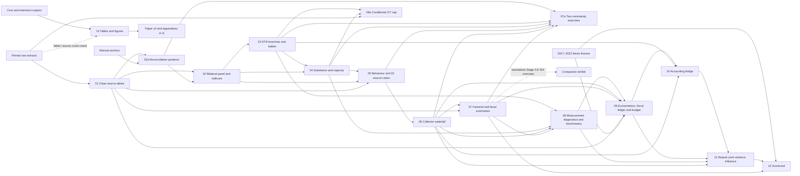

# Current architecture

R01 audit of `16dc40d`, the clean tip of `publication-rework` on 15 November 2026. The inventory and line numbers below describe that revision. [Baseline verification](../refactoring/baseline_verification.md) records what ran. [The scientific register](../refactoring/scientific_issue_register.md) distinguishes implementation findings, empirical assumptions and duplication. [REPLICATION.md](../../REPLICATION.md) remains the replicator-facing source and exhibit guide.

## R08. Constrained-Beta numerical kernel

[Stage 03](../../code/03_stage1_etr.R#L7) sources [`measurement/beta_fit.R`](../../code/measurement/beta_fit.R), which owns the percentile grid, log-precision bounds and boundary tolerance. The existing Stage 03 names remain available through the same source path. The module provides percentile conditioning, empty fits, guarded tail and quantile evaluation, `stage1_minimise()`, the mean-anchored fitter, and Beta mass, first moment, conditional top-up gap and bracket shares. It can be sourced alone. The tail functions use the shared `GMT_RATE` when the caller omits the threshold.

`fit_constrained_beta_percentiles(q, target_mean, probs, upper_cap, quantile_function)` takes fractional rates. Its default probabilities are 0.05, 0.25, 0.50, 0.75 and 0.95. The knots are clipped to [0, cap] (cap 1 when omitted) and made non-decreasing by cumulative maxima. The anchor is clipped to [0, 1]. A missing knot or mean gives the original missing-fit record. At either endpoint within `1e-8`, the fitted quantiles are the corresponding point mass, with missing shapes and precision. An interior fit minimises the unweighted squared quantile error over `log(c(1e-4, 1e6))`, with shapes `mean * precision` and `(1 - mean) * precision`. The cap affects observed knots and the choice of search. The fitted Beta retains unit support. Non-finite objective predictions receive `.Machine$double.xmax`. The ordered result contains both shapes, precision, mean, SSE, MAE, maximum absolute error, boundary flag and fitted quantiles. Rates and gaps are fractions and SSE is in squared fractions.

With `upper_cap = NULL`, the fitter calls `stats::optimize()` at its default tolerance `.Machine$double.eps^0.25`. A supplied cap, including 1, selects `stage1_minimise()`. That search includes both endpoints and the interval-wide optimum and checks local minima detected on a nine-point grid. Its searches use `tol = 1e-8`. Both the objective and reported quantiles use the same passed-in evaluation function.

Before R08, Stage 08's `fit_audit_mean_beta()` cloned the fitter and rebound its quantile function in a new enclosing environment. It now calls the shared fitter with an explicit audit strategy. The production `beta_quantiles()` retains its initial `qbeta()` values, muffles warnings containing `qbeta`, and restricts retries to interior probabilities. For the reflected CDF it caps the initial upper-side argument at 1. The audit routine suppresses all initial `qbeta()` warnings, clamps the initial vector to [0, 1], and checks all probabilities. Both retry non-finite CDF residuals or absolute residuals above `1e-8` through reflected log-odds inversion on [−746, 746] with root tolerance `1e-10`. The lower-tail helper uses the leading incomplete-Beta term below `1e-16`. An out-of-bracket root can resolve to 0 or 1. The production evaluator and the audit **mean-fit wrapper** use the mean for all quantiles when precision exceeds 100,000. The audit evaluator used directly by the two-shape and hurdle fits retains its full quantile variation.

| Caller and observation support | Knots, anchor, search and outputs |
|---|---|
| Stage 03 host-year production fit | FY2021–2023 Table I knots pooled over parents, Panel A.I preferred and Table I total fallback available to non-EU hosts. The anchor is aggregate accrued tax over eligible positive corrected profit, clipped to the host ceiling. Capped production Beta supplies shapes, fit errors, low-tax mass, conditional gap and liability rate when the percentile branch is selected for L3. The uncapped fit and rank-bounded precision are also retained for comparison and transport. |
| Stage 03 `fit_matched_beta_metrics()` and Stage 08a S1/S2/S3 | S1 is pooled host-year (361), S2 restricts both tables to the same parent set within host-year (70), and S3 matches the same bilateral cell (81). S1 uses the host mean, S2 the recomputed parent-restricted mean and S3 the bilateral regression mean. Capped and uncapped production fits retain the direct Table IV benchmarks, fitted-minus-direct errors and matched calibration statistics. Stage 08a substitutes standard combined or standard central caps while holding anchors, Table IV, BSPI, profit and SBIE fixed. |
| Stage 03 `ladder_bilateral_fits()` and Stage 08 rank audit | Positive-profit bilateral cells in FY2021–2023 with a finite Stage 1 bilateral mean and Panel A.I or eligible non-EU total knots. The rank-consistent caller selects `M1b` with host cap and uses fitted precision, low share, gap, RMSE and rank flags. The historical comparison caller uses uncapped `M1`. Stage 08 also evaluates `M1a`, cap-only and the five blend weights on the matched samples, then propagates the named alternatives through its separate ladder diagnostic. |
| Stage 08 `fit_percentile_model()`, `fit_quantile_rows()` and pooled/bilateral comparison | Uncapped unit-conditioned Table I knots, evaluated on S1/S2/S3. The pooled/bilateral diagnostic reuses the estimator selected by S3 liability MAE on eligible positive-profit cells, borrowing the host mean when the bilateral anchor is missing. M1 shares the one-parameter loss using the audit guard. M2 estimates two log-shapes on [−14, 12] by four bounded L-BFGS-B starts and admissible Nelder–Mead polish. M3 adds a zero mass from zero knots, scales positive-tail probabilities and uses a mean penalty or anchor-implied point for sparsely identified positive tails. M4 uses a piecewise-linear CDF with a bounded mean-implied final knot. M5 integrates a monotone Hyman quantile spline. Outputs include low share, gap, liability rate, fitted mean and estimator-specific convergence or support flags. These five-family comparisons are diagnostics. |
| Stages 08, 08a and 10 ladder reruns | `step10_update_measurements()` consumes precomputed host and bilateral fits. It replaces the L3 percentile branch and preserves direct Table IV precedence in L4. Stage 08a separately refits the host and rank-bounded bilateral arms under the alternative ceilings. Stage 10 refits capped host Beta and rank-bounded transport with a switched accounting tax numerator and keeps production source priorities. |
| Stages 07a and 11 uncertainty | Stage 07a reads the host fit outputs and cross-validation residuals and runs drawn shares and gaps through the source and collector calculations. It does not refit Beta per draw. Stage 11 inherits Stage 03 via Stage 10 and propagates uncertainty through its keyed measurement and collection objects. |

`stage1_fit_cell()` retains the distinct rank and lower-tail methods in Stage 03. `M1_Baseline` fits unit-conditioned knots without rank constraints. `M1a_StatCap_LowerTail` raises the lower precision bound to `1 / max(mean, 1 - mean)` and drops the 95th-percentile loss term only if the raw knot exceeds the cap. `M1b_RankBounded_Beta` searches the feasible intervals of the Beta CDF at 15%, retaining all detected feasible intervals across non-monotone sections and any feasible endpoints. The closest available precision is used if an interval is unavailable, and the final share is projected onto the observed rank bounds. Those bounds come from the unit-conditioned knots before statutory capping, with capped ranks tracked separately. The conditional gap follows the existing truncated-moment calculation at the selected mass. The blend still varies the share between rank interpolation and the `M1a` fitted share at weights 0, .25, .5, .75 and 1 and then evaluates the tail gap.

Stage 03 retains source selection, Table IV completeness diagnostics, BSPI transport and the full ladder. L1 and L2 use host and bilateral average rates. L3 uses pooled direct Table IV, selected Table I fits, transported BSPI and average fallback at their existing priorities. L4 uses exact bilateral Table IV then eligible Table I fits. Anchored L4 can transport Beta precision (pair, host-year, host median) before falling back to the bilateral mean, while strict L4 omits precision transport. The pair-BSPI sensitivity remains separate. The checked outputs retain raw and conditioned knots, cap and anchor, fitted parameters and rates, and all source, support, fallback and rank metadata. [R07 numerical fixtures](../../tests/testthat/fixtures/r07-beta-characterisation.rds) · [R08 tests](../../tests/testthat/test-beta-fit.R).

## R07. Bilateral panel assembly

Stage 02 delegates its initial assembly to [`code/panel/bilateral_assembly.R`](../../code/panel/bilateral_assembly.R). `build_bilateral_spine()` takes cleaned Table I plus the current year and jurisdiction sets. It excludes the same 12 aggregate affiliate codes, sorts by `(parent, affiliate, year)` and derives the existing pair, year, geography, holding and adjusted-profit fields. The key denotes a reporting-parent × affiliate jurisdiction × observation-year aggregate. Multiple parents can share an affiliate-year.

| Input | Cleaned grain and prepared lookup | Attachment to the spine |
|---|---|---|
| Table I | Parent × affiliate × year. 21,732 cleaned rows before the existing filters. | Defines the 20,111 ordered bilateral cells. |
| Table II | Parent × affiliate × year, with existing `t2_` names. | One-to-one |
| Tables III and IV | Each adds an ETR bracket to the bilateral key. Selecting `rate_0_15` in each leaves 6,817 and 1,295 unique bilateral rows respectively. III groups by MNE-group ETR. IV groups by affiliate ETR, and its spine projection uses uncapped employees. | One-to-one |
| Table V | Parent × year. Its 244 rows supply parent-level fields to each affiliate of that parent. | Many-to-one |
| Table VI | Parent × affiliate × year × size class. The 10,140 long rows widen to 4,371 bilateral rows. The eight measure families retain the original names and size-class encounter order. | One-to-one |
| Jurisdiction metadata, CbCR filing requirements and OECD legal classifications | Jurisdiction, after the existing precedence and summaries. The underlying filing records include measure, and the Central Record includes rule type. | Many-to-one, on the applicable parent or affiliate |
| Statutory rates, macro controls and BEPS flags | Jurisdiction × year after preparation. BEPS records retain rule, measure and regime before reduction. | Many-to-one, on parent or affiliate × year as required |
| Selected wages | Affiliate × year after selection. The cleaned OECD rows retain currency, price base and base year, and the ILO rows retain currency, sex and sector. The nearest-year search deliberately joins multiple candidates before selecting one wage. | Many-to-one, with source, source year and year gap |
| Stage 02a reconciliation | Parent × year. The 376 prepared rows carry the point and interval correction rates, evidence and support, posterior SD and provenance flags. | Many-to-one |

`prepare_cbcr_bilateral_lookups()` and `attach_cbcr_bilateral_lookups()` preserve the projection and attachment order. `attach_bilateral_lookup()` validates the left bilateral key and the declared right key, uses an explicit join relationship and checks the resulting key sequence and row count. `attach_profit_reconciliation()` applies this contract to the prepared Stage 02a projection. Duplicate attachment keys fail, as do duplicate Table VI keys before widening. Unmatched keys remain in the panel with missing lookup values. Matched zeros remain zero, and matched missing values remain missing. Lookup key membership distinguishes a missing match from a matched missing value without adding columns. The frozen spine has 2,671 unmatched selected-wage cells and 19,158 unmatched low-bracket Table IV cells. Four matched low-bracket cells have positive profit with missing accrued tax. Every frozen spine row matches a reconciliation key.

[`run_base_panel()`](../../code/02_base_correction_and_merging.R#L26) still reads inputs, prepares supplementary lookups, selects wages, projects the reconciliation fields, calculates profit, payroll and ETRs, and writes the panel and diagnostics. Jurisdiction metadata still keep the first record for a repeated code. The World Bank's Kosovo record, normalised from `XKX` to `XKV`, precedes the identical manual fallback. The filing lookup still takes the first non-missing threshold, with no competing non-missing thresholds in the freeze. The Table IV pooled affiliate–year–bracket and bilateral parent–affiliate–year–bracket sidecars retain their separate caps and denominators. FATS shares, sector bridges and crosswalks, the BEA benchmark and intangible-investment diagnostics keep their separate grains. The Stage 02a model, Stage 02 CLI, all 30 Stage 02 files, and the ordered 20,111 × 403 panel contract with 18,954 main-year cells are preserved.

## R11a substance methods

Stage 04 adapts the pinned Stage 1 panels, FATS share sidecar and hypothetical transition schedule to three calculation modules under [`code/substance/`](../../code/substance). `aggregate_sbie.R` computes dollar SBIE, the clipped profit shield and the bilateral Stage 2 ledger. `sectoral_sbie.R` checks the existing FATS share sums and join keys, allocates host totals using three component-specific weights and constructs sectoral rates. `sbti_capacity.R` provides the two activity legs, the sector maximum and the diagnostic floor overlay. The 2022 reference and 2021–2023 endpoint selections, host aggregation, H5 regressions and writers remain in Stage 04.

Stage 05 uses the sectoral liability bridge for the bundled factor, while Stage 09 keeps its separate sector-only and overlay-only arms. Stage 11 now takes the same dollar capacity coefficients through the Stage 04 source chain. The repeal game retains its low-profit allocation, relief and expenditure definitions. The sparse evaluator retains its own draw-specific denominators and collector projection. [Grains, original formulas, support exposure and verification](../refactoring/r11a_substance_methods.md).

## R10b Table IV support

[The support module](../../code/measurement/table_iv_support.R) classifies original OECD measure observations and validates the three dollar measures against the cleaned bracket pivot. Stage 01 retains a measure ledger for the revised mode. Stage 02 evaluates the published 15%-compatible profit partition and required lower tax at host-year and parent–host–year grains. The support ledgers retain partial subtotals, counts, rejection reasons and conditional bounds. The bilateral sidecar carries its own exact-point eligibility independently of host support.

Stage 03 uses the same support requirement for current direct points and for each BSPI source year. The source hierarchy and weight formula are unchanged. The host transition output records the legacy and revised selectors and exact anchor years. Stage 10 evaluates cash and envelope numerators separately on the accrued-bracket population and reports unobserved transitional criteria individually. Stage 07a and Stage 11 recalibrate from the revised overlap sample under their existing draw laws. `LEGACY_PUBLISHED` omits new outputs and preserves the old schema, selectors and diagnostics. [Specification and verification](../refactoring/r10b_table_iv_support_revision.md).

## R09b statutory-rate roles

[Stage 01](../../code/01_data_cleaning.R) parses the pinned OECD measure, sector and targeting codes into a jurisdiction-year-series provenance table and a jurisdiction-year role lookup. [The rate module](../../code/rates/statutory_rates.R) owns fractional conversion, role and fallback selection and the statistical ceiling formula. Stage 02 attaches the lookup as separate parent and affiliate projections through the existing bilateral join, preserving unmatched keys. The R06b aliases remain in percentage units. The ordered bilateral grain and Stage 02a attachment remain the same.

The leading statistical ceiling uses the standard combined rate and the same-year standard central fallback, with a five-point allowance and a unit ceiling when both rates are absent. Stage 02 applies the bilateral mean rule, Stage 03 uses the same ceiling for host means, percentile knots and rank-bounded fits, and Stage 10 reuses it when changing the tax numerator. The independent regression ETR and corrected profit denominator retain their former definitions. Stage 02a still uses the historical prior. Stages 05 and 09 distinguish the combined exact-lag statutory instrument, the historical ordinary-CIT destination gate and the combined marginal-price proxy. They price after routing and keep the source effective loss separately. Stage 09 produces the crossed gate/price ledger. The applied baseline response uses the exact historical slope recorded by Stage 01. [Rate-decision evidence, output contracts and legacy replay](../refactoring/r09b_statutory_rate_revision.md).

## R06a. Behavioural schedule diagnostic

[The standalone diagnostic](../../code/diagnostics/behavioural_notch.R) first reconstructs Stage 05 from frozen R05b inputs. It replaces the behavioural schedule in an isolated evaluation environment for Stage 07a, Stage 10 and Stage 11 calls. The common source spine is scenario × parent × affiliate × observation year. Stage 06 routing retains the frozen source predicates, verified collector map and parent-year weights. Stage 09's ordinary-CIT destination routing is a different operation, with a different fiscal ledger and its own activity fallback.

The detailed allocator and the sparse evaluator are compared at matched source keys, before collection. The sparse path also runs its actual collector operator, including explicit non-EU, extinguished and unsupported weights. The profit-only Stage 07a path varies the filter between specifications and holds it fixed within the point projection. The measurement-draw path rebuilds the schedule. The Stage 10 transitional screen tests a separate accounting basis and acts on liability remaining after the behavioural treatment. [Mechanism, diagnostic contracts and acceptance results](../refactoring/r06a_behavioural_notch.md).

## R06b. Continuous production schedule

`GMT_BEHAVIOURAL_SPECIFICATION` selects the production schedule. Stage 05 constructs the active bandwidth plus the three stylised sensitivities and selects the active schedule before joining affiliate-year measurements onto each core source. The Stage 07a measurement draws rebuild the stored schedule and select the same width. The profit-only draws read the behavioural filter at the production point. The stress tests, accounting bridge, repeal game and sparse evaluator inherit the active `apply_behavioural_regime()` contract when they reprice ETRs. The 2026 transitional screen applies separately to the remaining liability. Exhibit regeneration reads the saved specification marker so it can render either vintage. [R06b scientific revision](../refactoring/r06b_continuous_behavioural_response.md).

## R05b. Production UTPR policy and residual accounting

Stage 06 now sources [the UTPR policy module](../../code/allocation/utpr_policy.R) and builds weights through `build_production_utpr_weights()`. The dated national evidence register is authoritative for the production recipient map. The `GMT_UTPR_SPECIFICATION` setting defaults to `VERIFIED_PARENT_ONLY`. The pinned Stage 05 IIR, QDMTT and SbS predicates still classify source liability. Stage 05's older UTPR aliases serve the historical mode. R1, R2 and R3 retain their QDMTT and IIR definitions.

For non-legacy replays, `stage4_5_utpr_policy.rds` carries the dated map and specification alongside the existing weight files. Parent-only modes persist an empty fallback table with its schema intact. Downstream readers obtain the three objects through `read_stage4_utpr_weights()`. The production allocator uses explicit reporting mode and retains unsupported parent-year pools. Stage 06 additionally writes `stage4_5_utpr_unsupported_sources.rds` at scenario × parent × affiliate × year. Missing metadata identifies the historical strict contract used by the archived fixtures. Strict mode remains available as an explicit allocator argument.

Stage 07a preserves zero EU share for a supported non-EU route and NA for missing support. The detailed measurement draws reuse the observed-activity weights. Stage 09 and the scorecard report the unsupported component separately from exports. Stage 10 carries unassigned liability through the accounting waterfall. Stage 11 adds unsupported weight to every applicable sparse column and rebuilds denominators after full opt-out. A fall in assigned receipts can therefore exceed the saving in source liability. Stage 13 reads the ledger and game diagnostics and presents the residual alongside collection and relief. [Scientific revision and verification](../refactoring/r05b_utpr_production.md).

## R04. Collector routing contract

This section records the historical contract retained under LEGACY_FALLBACK.

**Source liability and channel.** Stage 06 takes one numeric post-behaviour top-up amount in USD per scenario, parent jurisdiction, affiliate jurisdiction and fiscal year. Jurisdiction codes are character, the year is integer, and the QDMTT, parent-IIR and SbS flags are logical. The detailed output also carries the reporting names and scenario variables, including factor labels and integer design indicators. At the Stage 06 boundary, missing amounts and negative amounts become zero, and missing flags become false. A zero or inactive amount contributes to no channel. For positive amounts, QDMTT takes precedence and is retained by the affiliate, including exempt US-parented sources. Without QDMTT, SbS extinguishes exempt liability. Otherwise a qualifying parent takes IIR, or the amount enters the UTPR pool. These four amounts sum to the normalised source liability. Potential routing in the sparse path uses unit liability and requires complete policy flags for every cell, including cells with a zero point amount.

**Eligibility and support.** Stage 06 retains the frozen jurisdiction flags and IIR-based UTPR proxy. It normalises non-negative employee and tangible-asset activity, using each component at 50% when both have support and the available component when only one does. Missing activity is set to zero and zero-weight collectors are omitted by the builder. Identical activity rows repeated across scenarios are deduplicated. Year fallback pools activity across parents within collector jurisdiction. Conflicting rows at the same routing key are rejected instead of choosing an observation or summing it as additional activity.

**Shared operations.** Stage 06 sources [`code/allocation/collector_routes.R`](../../code/allocation/collector_routes.R), inherited by the callers of Stage 06. `validate_utpr_weights(weights, eu27)` checks the two keyed tables for complete, unique parent–year–collector or year–collector keys, finite non-negative numeric shares, consistent logical geography, and within-tier sums of one (absolute tolerance `1e-8`). `expand_utpr_routes(pools, weights)` takes validated weights, expands within the parent–year when present, and otherwise uses year fallback. With neither tier, the original key survives with missing collector and weight. A valid non-EU-only parent-year has an EU share of zero and takes precedence over fallback. Missing recipient support and collection routed outside the EU27 are distinct. Joining keys determine the match; output ordering follows the existing parent-tier then fallback ordering.

| Path | Projection and estimand |
|---|---|
| Stage 06 detailed | Aggregates positive UTPR liability by scenario, parent and year before joining routes. QDMTT and IIR route directly to the affiliate and parent respectively. Weights also carry the collector name, tier label and logical explicit/ambiguous provenance for the global USD output, grouped by scenario, collector, year, channel and provenance. The EU27 outputs filter by collector location and complete country-years for scenarios present in the EU channel table. A positive unsupported pool fails before reporting. Pool and scenario-year conservation retain the US$0.001 absolute tolerance. |
| Stage 07a profit-only | Holds the ETR, behavioural filter and selected policy/weights fixed, recomputing source amounts as profit and the shield ratio vary. It uses the common channel classifier and collapses each validated tier to an EU fraction, grouped by parent–year or year. It multiplies the drawn UTPR pool by the selected fraction, aggregating USD by SbS arm, and rejects positive unsupported UTPR. Supported non-EU collection is included in global assigned revenue. The separate 500-draw measurement-error exercise recomputes its inputs and calls the detailed allocator. |
| Stage 09 domestic projection | Uses the Stage 06 source components plus numeric corrected-profit and low-taxed-profit measures. On EU27 affiliates, uses the selected tier's weight for collector equal to the source affiliate. A supported pool with no same-jurisdiction recipient has zero domestic UTPR. The remaining supported amount is exported from the source, possibly to another EU27 country. USD amounts are grouped by source country, scenario and year, then combined with a separate Stage 06 collector table in the ledger. Positive unsupported pools are rejected. |
| Stage 11 sparse | At fixed law and weights, builds an EU collector-year by source-cell matrix after using the same route expansion and keeping each cell index. The remaining supported assigned fraction is non-EU weight. A separate flag identifies SbS extinction. The builder requires a route for each potential UTPR cell and checks column closure within `1e-12`. Repeated products take non-negative source USD in matching column order and return collector USD, which the scenario evaluator scales to USD billions. |
| Stage 11 repeal and opt-out | Reclassifies source amounts and calls Stage 06. Repeal alone retains the collector weights. Full opt-out rebuilds them with the deviating collector removed. Host-only spillover calculations still check positive UTPR pools when the outer scenario-year check is disabled. Modelled receipts remain distinct from firm savings, extinguished amounts and observed revenue. |

For a source amount $p_i$ and valid route weights $w_{ci}$, assigned USD at collector $c$ is $\sum_i w_{ci}p_i$. The detailed path can sum UTPR amounts before routing because the route weights are constant within a parent–year. The collapsed EU and domestic projections sum or select entries of the same weight column, avoiding collector-level expansion. For each positive UTPR source with support, assigned UTPR equals its pool. Across all sources, liability equals assigned EU plus assigned non-EU plus extinction plus unsupported residual. The shared expansion preserves unsupported mass for diagnosis. The production projection paths fail on unsupported positive pools, and the sparse operator also requires potential coverage. [Independent fixtures](../../tests/testthat/test-collector-routing.R) verify per-cell channels, keyed country-year totals, row reordering, two liability vectors and tolerance scaled to floating-point summation. [S04](../refactoring/scientific_issue_register.md#s04-legacy-and-sparse-revenue-calculators) records the earlier off-support behaviour.

## R05a. UTPR legal evidence and standalone shadow

[The UTPR register](../../data/legal/utpr_eligibility_2026.csv) is keyed by jurisdiction, rule and legal evaluation date. [The standalone shadow](../../code/allocation/utpr_eligibility_shadow.R) reads it alongside frozen stage outputs. The 15-stage runner does not source the diagnostic. The mapper compares independent national applicability, qualification evidence and Article 50 with the frozen IIR-derived flags. Unknown status stays visible. The provisional arm admits unresolved candidates explicitly.

The shadow rebuilds parent-year and fallback weights with Stage 06 functions, then projects positive pools through the validated R04 expansion. It reports supported parent-year, fallback and unsupported amounts at scenario × parent × observation year. QDMTT, IIR and extinction stay fixed within each R1 or R3 source counterfactual. The allocation adapters still fail fast in production. Stage 11's R3 and deviation constructors supply corresponding source liabilities for the targeted Ireland and Cyprus comparisons. The [results and reproduction command](../refactoring/r05a_utpr_shadow_results.md) identify the separate diagnostic outputs and the numerical LEGACY checks.

## R03. Budget and accounting-waterfall exhibits

Stage 13 sources [`code/publication/budget_waterfall.R`](../../code/publication/budget_waterfall.R) once in its own environment. `write_paper_v2_exhibits()` supplies the existing CSV reader and passes the diagnostics to the table writer and selected data to the figure builder. The stage retains the CLI, common formatting, output directories, PDF device and alias copying. The CbCR extension table uses the same eight-country vector owned by the module.

| Input diagnostic in `data/processed/diagnostics/` | Contract and use |
|---|---|
| `step9_budget_benchmark_scenario_ranges_r04b.csv` | Stage 08 checks the exact L1/L3 partition and its Stage 06 source and collector support, then computes channel-matched ranges and interval distances. `paper_budget_rows(data, scope)` expects one selected benchmark per country and window for any of the four scenario scopes. Table 6 shows the two unrestricted ranges and the appendix shows the policy-matched pairs. Figure 3 continues to repeat the FY2023 comparison benchmarks across panels. |
| `step9_ladder_budget_backtest.csv` | Historical ladder comparison, retained for its archived consumers and for reproducing the original Table 6 estimates. |
| `step12_cbcr_to_budget_waterfall_bridge.csv` | `paper_waterfall_rows(data)` selects the separate waterfall records by collector, window and step. Duplicate selected keys fail explicitly. The six factor levels fix the stage order. Missing amounts or individual steps retain the existing blank table cells. |
| `step12_conduit_unwinding_time_series_2017_2026.csv` | Figure 3 uses the all-parent annual series for the Netherlands, Luxembourg and Ireland over 2018–2023. These are modelled collector revenues on historical CbCR, in EUR billions. The module consumes the upstream conversion and annualisation. |

`read_budget_waterfall_inputs(read_diagnostic)` reads the three current diagnostics once and checks required columns and numeric types. `write_paper_budget_tables(budget, waterfall, output_dir, format_number, write_table)` formats the analytical ranges and the separate waterfall and delegates TeX I/O to the shared float-table writer. `make_paper_waterfall_figure(backtest, waterfall, history)` returns a ggplot object constructed from the selected data. The canonical fragment, numbered Table 6 alias and Figure 3 PDF retain their names and labels. [R04b comparison and provenance](../refactoring/r04b_budget_benchmarking.md).

[Fixture tests](../../tests/testthat/test-budget-waterfall.R) cover input structure, the selection and missingness contracts, table cells, and plot data and mappings. [Manuscript integration tests](../../tests/testthat/test-manuscript-exhibits.R) verify the canonical fragment, alias bytes and figure reference. [Source safety](../../tests/testthat/test-source-safety.R) also checks the module independently.

## Execution and economic lineage

[`run_all.R:21–44`](../../run_all.R#L21) runs 15 scripts in separate `Rscript --vanilla` processes and stops on the first non-zero exit. The order is **01, 02a, 02, 03, 04, 05, 06, 07, 07a, 08, 09, 10, 11, 12, 13**. Each stage writes intermediate files, so prerequisites are artefacts on disk even where the producing script is never sourced. Dates embedded in output names such as `step5`, `step10` and `step15` refer to different rounds of development. The earlier [R guide](../R_guide.md) records the project’s tidy-data, fail-fast and scientific logging conventions. The [Step 16 inventory and registry](../../tests/step16_refactor_audit.md) predate consolidation. The [blueprint](../../writing/paper_v2_blueprint.md) is an editorial plan with historical exhibit names. Use [the current TeX](../../writing/paper_v2.tex) and its includes as the publication dependency roots. Since `d9a2db4` the checkout gained the cap diagnostic, exhibit and hash checks, BEA temporary-file fixes, updated publication fragments and a renamed research note.

Conceptually the panel estimates **source liability**, then allocates it to **collectors**, then compares designs and uncertainty. Profit reconciliation supplies the corrected positive denominator. ETR measurement supplies low-tax profit share and the conditional gap. Substance and behavioural scenarios reduce the liability. Legal routing takes that amount as input. Behavioural profit relocation supplies a separate ordinary CIT calculation, whose destinations differ from the collectors of top-up tax. The accounting bridge is an alternative profit base and sensitivity programme built after the core run. It feeds a second factorial, while the joint parameter simulation evaluates the core design. Official forecasts supply comparison benchmarks. The scorecard compares vintages. Reporting is the last scheduled operation, with an older overview emitted by stage 07.

The diagram shows principal **data** edges. The execution sequence above also orders ancillary writes. The source dependency table below describes a different graph.

### Inputs and grains

| Input or intermediate | Contract and consumers |
|---|---|
| [Pinned raw manifest](../../tests/step17_raw_inputs.sha256) and [FY2023 acquisition metadata](../../data/raw/fy2023_input_manifest.csv) | 54 exact paths, including manual anchors, staged upstream downloads and provenance files. 01 reads CbCR I–VI, OECD tax rates and earnings, ILO, Eurostat inward FATS, GFS and ECB FX, sector accounts, BEA, World Bank, BEPS and the OECD Central Record. See exact per-file intake at the end of this report. 09 also directly reads OECD comparative CIT revenue and uses the 01 Eurostat/ECB reader. 08a reads the statutory OECD extract directly. 13 optionally reads raw Table I for source counts, with a pinned metadata fallback. |
| OECD clean CbCR | Table I has parent, partner, year and panel strata with positive-profit A-I separate from net/all-group Panel A. Table IV adds ETR bracket and retains published missingness. II, III, V and VI have distinct aggregations. Table III is classified by MNE-group ETR. Its ratios are diagnostic alongside local Table IV, and size bins are group-level anchors. Stage 01 also writes supplementary tables at jurisdiction-year or country-sector-year grains. |
| Reconciliation posterior and manual anchors | 02a combines OECD adjusted-profit, ETR parity and optional manual evidence on bounded logit scale by parent-year. The early revenue sensitivity is a proxy. 02 consumes the posterior to select preferred/lower/upper corrected bases; 07a and 11 sample posterior uncertainty. 08 validates the correction and 13 presents it. |
| `base_panel.rds`, `base_panel_t4_*.rds` and activity sidecars | 20,111 bilateral cell-years and 403 columns in the main panel. Table IV retains both pooled affiliate-year and bilateral partitions. Sidecars include FATS/EUKLEMS NACE weights and BEA validation. 03 uses the panel and Table IV; 04 uses activity sidecars; 05 and later audits also read the base panel. |
| `stage1_affiliate_year.rds`, `stage1_bilateral_panel.rds` | Host-year and parent–affiliate–year rates and amounts. Preserve the distinct supports of average, pooled direct, fitted Beta, BSPI, strict and anchored cases. 04, 07a, 08, 10 and 11 consume the measured cells or their validation data; 07 also uses bilateral imputation exposure. |
| `stage2_bilateral_panel.rds`, `stage2_affiliate_year.rds`, `stage2_sectoral_matrix.rds` | Append carve-out rate scenario to cell or host key; add sector for sectoral objects. The asset/payroll imputation and bracket-specific substance matter for the resulting excess-profit base. 05 consumes the case-specific inputs; 07a/08/09/10/11 reuse them under separate perturbations. |
| Stage 3 models/schedules and `stage3_factorial_panel.rds` | Estimation support differs from simulation support. Model form, identification sample, clustering and selected slope matter. Scenario source amounts are keyed by parent, affiliate, year and scenario ID. The five binary factors are ETR measurement, substance treatment, transition rates, SbS and behaviour. `x10011` is the preferred behavioural SbS case, `x10001` its universal counterpart. 06 starts from pre-routing liability. |
| Stage 4.5 source panel, parent-year/fallback weights and collector outputs | Sources and collectors are different keys. Source = scenario × bilateral cell; routing weights = parent × year × collector, or year × collector for fallback. Detailed channel receipts include allocation-weight source and policy provenance flags; final EU27 matrix completes scenario × country × year with structural zeros (6,048 rows). Flows feed 07, 07a and 08–11. |
| 07 output and archived vintages | Scenario summaries, pooled country-year sums of squares, Shapley, fiscal denominators, salience and PCA/clusters. The 2017–2022 archive provides explicitly older objects for 09 vintage comparisons and 12; 01 has an archived monthly-ILO fallback. Archive TeX is a historical fixture. Scope, time aggregation and USD/EUR convention require explicit treatment. |
| 08–11 named extensions | 08 uses its own source-defined budget metadata, reused by 09. 09's `step7_official_budget_forecasts_backtest.csv` is then read by 10; its matched comparator and cash/structural scope travel in the file. 10 runs the conduit adjustment, current/prior loss, numerator and transitional safe-harbour screens. 11 consumes accounting objects and inputs from the core and 08/09 to generate policy games, 64-case accounting factorial, joint 32-case parameter uncertainty and influence analyses. |
| Publication | 13 reads analytical RDS and diagnostic CSV; outputs numbered paper and appendix tables, legacy fragments/manifests and eight PDF figures. The current paper directly includes one hand-authored filter figure drawn with TeX. The other four main-text figures and three appendix figures are generated. The eighth generated PDF is a companion figure. [REPLICATION.md, exhibit map](../../REPLICATION.md#exhibit-to-code-and-data-map) gives per-table/figure input paths. `writing/make_paper_bib.py` projects the cited entries from `bibliography.bib` to `paper_v2_refs.bib`; LaTeX and BibTeX compile the manuscript. The research note has its own source and build. |

### Source dependencies and configuration

IDs below are the file prefixes. `00h` means `00_helpers.R` and `00c` means `00_config.R`. The third column excludes direct imports. Every numbered analysis stage and 08a has a direct-execution guard and can be invoked from the checkout root **after its input artefacts exist**. 01 can start from raw inputs and the required system library. 08a and 13 can start from a complete frozen input tree, with the raw inputs specified above. Loading definitions alone does not run a stage.

| Script | Direct `source()` into caller's environment | Transitive-only source dependencies |
|---|---|---|
| 00c | None | None |
| 00h | 00c | None |
| 01, 02a, 02, 03, 04, 06, 07, 13 | 00h | 00c |
| 05 | 04 | 00h, 00c |
| 07a | 05, 06, 07 | 04, 00h, 00c |
| 08 and 10 | 03, 05, 06, 07 | 04, 00h, 00c |
| 08a | 08 | 03, 05, 06, 07, 04, 00h, 00c |
| 09 | 01, 05, 06, 07, 08 | 03, 04, 00h, 00c |
| 11 | 10 | 03, 04, 05, 06, 07, 00h, 00c |
| 12 | 11, 09 | 10, 08, 01, 03, 04, 05, 06, 07, 00h, 00c |

- [`00_config.R:3–18`](../../code/00_config.R#L3) resolves paths once on source. `GMT_PROJECT_ROOT` anchors most source paths and selected metadata. Relative raw, archive and default output paths, and literal filenames in [the direct-run guards](../../code/00_helpers.R#L143), still depend on the working directory. `GMT_OUTPUT_ROOT` redirects processed/diagnostic/generated files together; tests use `GMT_TEST_OUTPUT_ROOT` for selected lookups, with manuscript and archive references resolved relative to the repository or original root. The 08a CLI defaults independently to the checkout's processed directory and writes a tracked CSV under `docs/`; its function accepts a different path. `run_all.R` accepts any output directory, including a reused one, and stages write progressively. A failed run can leave a mixed tree.
- [`00_helpers.R:7–45`](../../code/00_helpers.R#L7) installs bare tidyverse names via promises. It skips any existing local binding, including a caller-provided binding, and resolves package exports on demand. Loading 09 can source the same core script via more than one path; loading 12 brings both 11 and 09 into one environment. This redefines constants, helpers and lazy tables while keeping already-bound imports. `renv.lock` specifies R and packages, but the documented vanilla invocation requires a library on `R_LIBS_USER`. A fresh child process protects ordered runs from cross-stage R bindings; it does not protect interactive use, direct function tests or same-environment source chains.
- The [source-safety test](../../tests/testthat/test-source-safety.R) covers files/directories, namespaces, attached packages, options and global bindings on import into a fresh environment. Some source actions intentionally affect local bindings: 08 creates a cloned Beta closure with alternate quantile routines at [08:66–72](../../code/08_measurement_and_cbcr_extensions.R#L66); 11 aliases core functions at [11:1049–1062](../../code/11_policy_game_and_variance_extensions.R#L1049). 13 captures directories on source at [13:3812](../../code/13_generate_exhibits.R#L3812) and [13:4516–4517](../../code/13_generate_exhibits.R#L4516). Its tests must update those derived paths as well as the root. RNG changes occur when several analyses run; the figure writer temporarily changes and restores `lifecycle_verbosity`.
- Common dependencies also include package methods reached at first use, serialized model-call symbols, the R/BLAS/locale combination, and LibreOffice `soffice` for 01's BEA workbooks. Offline replication assumes the pinned raw files already exist. `code/collect_all_data.py` is a separate Python/`requests` acquisition program with source selection, revision and file-write semantics. `writing/make_paper_bib.py` and LaTeX are later publication steps.
- The [golden verifier](../../tests/verify_golden_step15.R#L28) checks exact path-set and SHA-256 parity for 360 CSV/RDS outputs. `testthat` adds intermediate contracts and regenerates manuscript tables separately. See the baseline report for results, limits and the current stale memo path.

## Module boundaries and complexity

Physical lines include blank lines and comments. Counts use parsed named definitions, first at file scope and then nested named assignments in parentheses. Anonymous callbacks are excluded. The detailed inventory below gives every file-scope R function and its span. Direct imports are in the preceding table and literal file references in the artefact index. “Test” gives the shortest route to the relevant suite under [`tests/testthat/`](../../tests/testthat/).

| Module and role | Responsibilities, contracts and side effects | Largest or most coupled area, seams and tests |
|---|---|---|
| **00c, shared** | Paths, windows, top-up floor, lists, scenario columns and reconciliation constants. Creates bindings when sourced. | Split run paths, data schema and model settings by ownership. Test `source-safety`, `pipeline-regression`. |
| **00h, shared** | Lazy package registry, key checks, missingness/units, bounded-logit and inference primitives, H4 pair and fixed factorial components, TeX escape and formatting. | `cluster_vcov` and `demean_two_way` house inference conventions. Move TeX helpers to reporting and statistical helpers to the method domain; characterise bare model calls before removing delayed imports. Tests `source-safety`, Stage 3, Stage 4.6, manuscript. |
| **01, core + exports** | SDMX parsing, source-specific cleaning, provenance and coverage; workbook conversion with temporary extraction and subprocess; writes 35 clean/diagnostic files. | `run_data_cleaning` 60–1173 mixes parsers with source-specific schemas, fallback I/O and publication-oriented coverage. Extract OECD/Eurostat/BEA readers one at a time. Test golden, source safety and fiscal denominators. |
| **02a, core + validation** | Reads clean CbCR, statutory rates and manual evidence; writes targets, posterior, draw and validation files; sets RNG for early sensitivity output. | `run_profit_reconciliation_model` 776–1053, `build_etr_parity_signal` 191–320 and `build_revenue_sensitivity_proxy` 649–774. Separate evidence construction, fit, posterior pooling, validation and export. Preserve individual anchor precision, logit bounds and held-out draws. Tests golden, base key coverage, 08 post-fit validation. |
| **02, core** | Table I spine, Table III proxy, pooled/bilateral Table IV, country and legal enrichment, wage/asset substitution, profit and ETR bounds, sector sidecars, diagnostics. Writes main panel + seven RDS sidecars and 22 CSVs. | `run_base_panel` 25–2054 (2,030 physical lines) spans data reads at 78, joins at 113/300, reconciliation at 555, imputations at 595, sector bridges at 875 and exports at 1501. Distinguish scientific alignment and construction from orchestration. Missingness and join multiplicity need intermediate fixtures before extraction. Tests golden, unique keys, Stage 1, Stage 2. |
| **03, core + validation** | Average, constrained-Beta, direct and BSPI at host grain; bilateral and rank-bounded ladder; matched validation and completeness sensitivity. Writes host and bilateral panels and diagnostics. | `run_stage1_pipeline` 989–2104 combines measurement, validation and writing. `audit_pooled_t4_completeness` 363–488 and `ladder_build_measurements` 873–974 use meaningful support rules. Keep tail numerics, knot rank and validation intersections in the method. Extract host branches, measurement selection and validation. Tests `stage1-etr`, `cit-cap-diagnostic`, golden. |
| **04, core + validation** | Applies initial/long-run SBIE to Stage 1, constructs sector weights and SBTI capacity, builds H5 regressions and sensitivity. Writes bilateral, affiliate-year, sectoral and related diagnostics. | `run_stage2_pipeline` 294–1243 bundles the major tables. Separate payroll/asset provenance, SBIE rates and sectoral capacity. Retain aggregate versus sectoral nonlinearity and strict/pooled ETR distinctions. Tests `stage2-sbie` and Stage 3 sector bridge. |
| **05, core + compatibility and diagnostics** | Fits FE/IV/alternative estimators, retains fit objects and schedules, applies exposure and bunching/reallocation, builds 32 source cases, reallocation matrices and early proxy revenue/H4. | `run_stage3_pipeline` 2718–3258; `build_factorial_revenue` 1991–2200 mixes case design, statute joins and calculation; `build_rule_a_global_reallocation` 2346–2532 is a separate destination estimand. Extract estimation and inference, source evaluation, legal inputs, and destination allocation into separate responsibilities. Test `stage3-behavioral`, golden and downstream collector conservation. |
| **06, core legal routing** | Takes Stage 3 source cases and collector activity. Classifies each amount, computes parent-year/fallback routes, allocates, checks conservation and writes diagnostics and revenue. | `run_stage4_5_pipeline` 578–769, `allocate_stage4_revenue` 221–356 and `run_stage4_5_h4_tests` 473–576. Separate route definition, execution and reporting; keep routing provenance, source-count semantics and complete EU grid. Tests `stage4-5-allocation-sbs`, `pipeline-regression`, golden. |
| **07, core + legacy presentation** | Uses collector/scenario outputs, Stage 1 exposure and CIT/GDP. Validates design, computes contrast estimands and Shapley, salience, PCA and k-means stability. Writes overview TeX in addition to RDS/CSV; sets clustering seed. | `run_stage4_6_pipeline` 1357–1817, `write_generated_latex` 1222–1355 and `build_measurement_sample_decomposition` 1065–1188. Make contrast/aggregation choice explicit; separate fiscal ratios, typology and rendering. Test `stage4-6-decomposition`, `pipeline-regression`. |
| **07a, publication sensitivities** | Legacy profit-only preferred perturbation uses frozen measurements, behaviour and routing flags; older Stage 1 measurement error draws rerun the design via 05/06. Writes 18 files, including 13 reused on verified cache hit. | `run_stage1_measurement_error_simulation` 846–1075 combines calibration, seeded draws, replay, aggregation and persistence. `compute_preferred_revenue_from_profit` 122–180 duplicates legal gates for a coarser estimand. Distinguish fast profit-only proxy from measurement perturbations. Test `stage1-measurement-error-simulation`, `pipeline-regression`, golden. |
| **08, paper and appendix analyses** | ETR/negative-tax and bracket-substance diagnostics, ladder counterfactuals, rank-fit/cross-validation replay, CbCR blending/size/activity and empirical reconciliation validation. Also owns budget input metadata, used indirectly by 09. | `run_cbcr_table_extensions` 1651–2255 incorporates four substantive analyses; `run_profit_correction_validation` 2259–2527 and `ladder_anova` 1082–1173 have independent contracts. Move by research question, with estimators out of diagnostic runners. Test `extension-outputs`, `cit-cap-diagnostic`, Stage 1 and golden. |
| **08a, optional standalone** | Reads raw rates and frozen host/cell/Stage 2, brackets and three CV samples. Replays conditional cap variants and writes one tracked audit CSV outside processed. | `run_standard_cit_cap_diagnostic` 27–196 interleaves captured support, validation and formatting. Keep as sensitivity caller of the measurement methods and explicit rate reader. `test-cit-cap-diagnostic.R` reruns it temporarily. |
| **09, paper and appendix analyses** | Division bias and clustered checks, Rules A/B/C and ordinary CIT recovery, budget comparison, ledger, R1–R3 legal sensitivities, vintage and specification stress, pre-reform notch. | `fit_division_bias_design` 81–182, `build_institutional_regime_matrix` 846–928 and `build_destination_comparison` 693–774. Keep distinctions among gross recovery, source losses and net receipts. Move econometrics, fiscal-flow and notch diagnostics into their owners. Test `extension-outputs`, `sesh-notch-bunching`, Stage 3 Rule B and golden. |
| **10, paper and appendix analyses** | Conduit/dividend shape perturbations versus loss/tax-timing bridge, threshold screening, revenue waterfall and trend. Consumes frozen core and official budget rows. | `run_hanlon_globe_bridge` 1236–1377 and `run_conduit_wedge_diagnostics` 481–603 use different route recomputations around a shared accounting story. Isolate stock tracking, support, tax numerator and reporting, then thread adjustments explicitly. Test `extension-outputs` and golden, with no dedicated loss-stock fixture in the current suite. |
| **11, paper and appendix analyses** | Repeal and SBTI deviation, sparse collector projection, joint MC, expanded accounting factorial, jurisdiction leave-out with re-estimation. Writes policy and uncertainty tables; seeds joint draws. | `run_jurisdiction_influence_suite` 1562–1778, `step15_monte_carlo` 738–870 and `normalise_case_summary` 1431–1555. Preserve sparse performance and separate design weights and country aggregation; extract policy game and influence from uncertainty. Test `extension-outputs`, `jurisdiction-influence-robustness`, hard point-parity check and golden. |
| **12, replication comparison** | Reads current and archived analytical outputs, emits single vintage-aware CSV. No source-time analysis. Main manuscript is fed by original analytical files, while the scorecard is a companion output. | `score_fiscal_flows` 335–454 and `score_steps12_to_15` 456–569 combine many file contracts. Remove broad extension imports once benchmark/schema dependencies are explicit. Test `extension-outputs`, golden. |
| **13, publication** | Reads upstream files, makes presentation transforms and ggplots, owns aliases, manifests and most TeX. I/O, rounding, selection, notes and caption assembly coexist; some optional appendices use existence checks. | `write_appendix_tables` 2724–3731 (1,008 lines), `write_data_descriptive_tables` 452–749 and `write_stage3_reliability_scorecard_table` 1838–2039. Split one exhibit family at a time with exact files and ordering as the contract. Tests `manuscript-exhibits`, `extension-outputs`, `pipeline-regression`. |
| **Python acquisition, runner, publishing** | `collect_all_data.py` (551 lines, 23 file-scope functions and one nested function) has a registry, HTTP downloads, OECD and World Bank wrappers, harmonised FATS gzip builder, BEA ZIP extraction and CLI. Writes raw extracts on explicit refresh. `run_all.R` (47 lines, `main()` with nested `run_script()`) controls the 15-process chain; `writing/make_paper_bib.py` (87 lines, four functions) writes a selected bibliography from TeX citation keys and the master bibliography. | Offline lineage and reproducibility depend on hashes, including a release bundle for ignored inputs. 01 is the cleaning boundary; the downloader is not a clean-replay dependency. Runner integration and the manuscript build provide their useful end-to-end checks. |

## Duplication and isolation priorities

1. **I/O defines the stage boundaries, with broad in-process imports.** 02 and 03 read, transform, validate, print and save across multiple research operations. Named inputs and outputs and tests at those boundaries will lower risk faster than moving files wholesale. In 09 and 12, imports at [09:3–7](../../code/09_econometric_and_reallocation_extensions.R#L3) and [12:3–4](../../code/12_master_scorecard.R#L3) expose whole extension modules to access individual helpers. Disambiguate `ladder_read`, `bridge_read`, `step8_read`, `read_stage5_input` and `score_rds` by using a small path/artefact boundary. Their differences include vintage, filename prefix and failure semantics. Keep source-compatible wrappers during migration.
2. **The same row grain wears several names.** `PAIR_KEY` [08:13](../../code/08_measurement_and_cbcr_extensions.R#L13), `STEP8_KEYS` [10:10](../../code/10_accounting_bridge_and_conduit_wedge.R#L10), `BRIDGE_KEYS` [10:607](../../code/10_accounting_bridge_and_conduit_wedge.R#L607), `NASH_KEYS` [11:7](../../code/11_policy_game_and_variance_extensions.R#L7), `STEP15_KEYS` [11:484](../../code/11_policy_game_and_variance_extensions.R#L484) and Stage 1's `LADDER_KEYS` all name `parent, affiliate, year` in the same order. Sharing those names does not imply uniqueness of scenario or bracket tables on the base key. Preserve the extra dimensions, row alignment assertions and join cardinality. The preferred scenario IDs recur in 07, 09, 10 and 11. Share an explicit named scenario lookup; keep fixed report-country selections, legal deferrers, activity hubs and exposure sets separate. Fixed 2023 display conversion 1.0813 (08:722, 09:639, 10:14/610) differs from the 01 historical FX series.
3. **Several liability and routing calculators exist.** 05's source proxy assigns UTPR to the host in its compatibility summaries. 06 implements detailed allocation. 07a's legacy profit-only path repeats the QDMTT/IIR/UTPR/SbS classifier and projects UTPR with an EU share; its Stage 1 error path calls the production allocator. 09 projects the home share of UTPR for the source ledger and 11 builds a sparse collector projection for the same routes. 08's ladder and 10's bridge change liability inputs before rerouting, legitimately. The [scientific register](../refactoring/scientific_issue_register.md#s04-legacy-and-sparse-revenue-calculators) specifies the comparison domains that make reuse safe. Distinguish missing observations, policy flags defaulted false, structural zeros in completed grids and missing routes.
4. **Factorial calculation and scenario construction recur at different grains.** [05:1991](../../code/05_stage3_behavioral.R#L1991) builds the five binary design; [08:1082](../../code/08_measurement_and_cbcr_extensions.R#L1082) uses binary and multi-level contrasts; [11:647](../../code/11_policy_game_and_variance_extensions.R#L647) has a light 32-case design; [11:942](../../code/11_policy_game_and_variance_extensions.R#L942) aggregates before computing effects. `factorial_binary_components()` centralises part of the calculation already. Pooling sums of squares across country-years versus squaring contrasts of cumulative receipts changes the estimand. Preserve four-level Helmert contrasts and factor orientation. Reuse a checked design and explicit contrast input where the result is mathematically identical.
5. **Recomputation and reporting accumulate by historical task.** 08 quantile audits intentionally use alternative fit objectives, including [the swapped quantile implementation](../../code/08_measurement_and_cbcr_extensions.R#L66). Other 08 ladder/rank routines replay overlapping fits and allocations. 10 and 11 rebuild common source/route inputs, while 13 reads some diagnostics repeatedly and renders aliases from other generated files. Start reuse only after comparing keys, support and input variation. `weighted_mean_available()` and `weighted_mean_clean()` differ on nonfinite observations; an all-missing `sum_or_na()` differs from `sum(..., na.rm = TRUE)` and matters for Table IV. `normalise_share()` and `normalise_positive_weights()` have the same current arithmetic, but their allowed input domains and fallbacks must be established before replacing either. Keep a source-level vs collector-level distinction at every handoff.
6. **Verification is strong at the final file boundary and uneven inside the methods.** One TeX generator block serves legacy and current exhibits, but stage 07 owns a separate TeX file. Some files have no focused toy fixtures. The 07a cache is tied to data and result hashes, not to the generator code, dependency versions or seeds, and uses `tools::sha256sum()` directly. A code change to the cached simulation can remain invisible on a cache hit. The hash verifier's portable system fallback is a separate path.

## Detailed inventory

### Function index

The counts and spans come from the R parser. Namespaces listed supplement base R and the lazy imports in 00h (dplyr, tidyr, readr, purrr, tibble and stringr). They describe explicit namespace syntax in each file; package calls can also be resolved indirectly through its source graph.

00_config.R · 66 lines · 0 functions (0 nested)

Explicit namespaces `base`.

00_helpers.R · 327 lines · 37 functions (0 nested)

Explicit namespaces `base`, `dplyr`, `stats`, `tidyr`.

[`declare_gmt_imports()`](../../code/00_helpers.R#L7) 7–15 · [`latex_escape()`](../../code/00_helpers.R#L47) 47–62 · [`safe_divide()`](../../code/00_helpers.R#L64) 64–66 · [`coalesce_zero()`](../../code/00_helpers.R#L68) 68–70

[`clamp_unit_interval()`](../../code/00_helpers.R#L72) 72–74 · [`clamp_interval()`](../../code/00_helpers.R#L76) 76–78 · [`normalize_code()`](../../code/00_helpers.R#L80) 80–85 · [`weighted_mean_available()`](../../code/00_helpers.R#L87) 87–91

[`weighted_mean_clean()`](../../code/00_helpers.R#L93) 93–97 · [`weighted_rate_clean()`](../../code/00_helpers.R#L99) 99–103 · [`bounded_logit()`](../../code/00_helpers.R#L105) 105–111 · [`inverse_bounded_logit()`](../../code/00_helpers.R#L113) 113–118

[`rho_to_logit_se()`](../../code/00_helpers.R#L120) 120–129 · [`sum_or_na()`](../../code/00_helpers.R#L131) 131–134 · [`max_or_na()`](../../code/00_helpers.R#L136) 136–140 · [`is_direct_script_run()`](../../code/00_helpers.R#L143) 143–149

[`assert_unique_keys()`](../../code/00_helpers.R#L152) 152–161 · [`pick_first_non_missing()`](../../code/00_helpers.R#L163) 163–167 · [`normalise_share()`](../../code/00_helpers.R#L169) 169–173 · [`row_min_or_na()`](../../code/00_helpers.R#L175) 175–179

[`safe_log1p_scale()`](../../code/00_helpers.R#L181) 181–183 · [`normalise_tax_rate_unit()`](../../code/00_helpers.R#L185) 185–187 · [`safe_cor()`](../../code/00_helpers.R#L189) 189–196 · [`first_non_missing()`](../../code/00_helpers.R#L198) 198–202

[`min_date_or_na()`](../../code/00_helpers.R#L204) 204–208 · [`winsorise()`](../../code/00_helpers.R#L210) 210–213 · [`rank01()`](../../code/00_helpers.R#L215) 215–226 · [`group_mean_matrix()`](../../code/00_helpers.R#L229) 229–235

[`demean_two_way()`](../../code/00_helpers.R#L237) 237–249 · [`cluster_vcov()`](../../code/00_helpers.R#L251) 251–272 · [`cluster_vcov_twoway()`](../../code/00_helpers.R#L274) 274–281 · [`format_bn()`](../../code/00_helpers.R#L283) 283–285

[`format_pct()`](../../code/00_helpers.R#L287) 287–289 · [`signed_log1p()`](../../code/00_helpers.R#L291) 291–293 · [`nan_to_na()`](../../code/00_helpers.R#L295) 295–297 · [`build_h4_pairs()`](../../code/00_helpers.R#L299) 299–309

[`factorial_binary_components()`](../../code/00_helpers.R#L312) 312–327

01_data_cleaning.R · 1,177 lines · 3 functions (14 nested)

Explicit namespaces `utils`, `xml2`.

[`read_eurostat_corporate_tax()`](../../code/01_data_cleaning.R#L19) 19–44 · [`append_cyprus_cit_revenue()`](../../code/01_data_cleaning.R#L46) 46–58 · [`run_data_cleaning()`](../../code/01_data_cleaning.R#L60) 60–1173

02a_profit_reconciliation_model.R · 1,058 lines · 11 functions (1 nested)

Explicit namespaces `stats`.

[`profit_reconciliation_source_precision()`](../../code/02a_profit_reconciliation_model.R#L34) 34–44 · [`build_parent_year_targets()`](../../code/02a_profit_reconciliation_model.R#L46) 46–116 · [`build_adjusted_profit_signal()`](../../code/02a_profit_reconciliation_model.R#L118) 118–189 · [`build_etr_parity_signal()`](../../code/02a_profit_reconciliation_model.R#L191) 191–320

[`expand_manual_anchor_signals()`](../../code/02a_profit_reconciliation_model.R#L322) 322–388 · [`fit_prior_reconciliation_model()`](../../code/02a_profit_reconciliation_model.R#L390) 390–464 · [`combine_parent_year_evidence()`](../../code/02a_profit_reconciliation_model.R#L466) 466–561 · [`build_holdout_validation()`](../../code/02a_profit_reconciliation_model.R#L563) 563–601

[`build_etr_balance_diagnostic()`](../../code/02a_profit_reconciliation_model.R#L603) 603–647 · [`build_revenue_sensitivity_proxy()`](../../code/02a_profit_reconciliation_model.R#L649) 649–774 · [`run_profit_reconciliation_model()`](../../code/02a_profit_reconciliation_model.R#L776) 776–1053

02_base_correction_and_merging.R · 2,058 lines · 2 functions (2 nested)

Explicit namespaces `dplyr`, `tidyr`.

[`cap_table4_employees()`](../../code/02_base_correction_and_merging.R#L12) 12–23 · [`run_base_panel()`](../../code/02_base_correction_and_merging.R#L25) 25–2054

03_stage1_etr.R · 2,108 lines · 32 functions (4 nested)

Explicit namespaces `stats`.

[`condition_stage1_percentiles()`](../../code/03_stage1_etr.R#L19) 19–24 · [`empty_beta_fit()`](../../code/03_stage1_etr.R#L26) 26–38 · [`beta_lower_tail()`](../../code/03_stage1_etr.R#L40) 40–48 · [`beta_quantiles()`](../../code/03_stage1_etr.R#L50) 50–100

[`fit_constrained_beta_percentiles()`](../../code/03_stage1_etr.R#L102) 102–175 · [`beta_mass_below()`](../../code/03_stage1_etr.R#L177) 177–186 · [`beta_first_moment_below()`](../../code/03_stage1_etr.R#L188) 188–199 · [`beta_avg_topup_rate()`](../../code/03_stage1_etr.R#L201) 201–212

[`beta_mass_between()`](../../code/03_stage1_etr.R#L214) 214–218 · [`beta_bracket_shares()`](../../code/03_stage1_etr.R#L220) 220–232 · [`average_rule_metrics()`](../../code/03_stage1_etr.R#L234) 234–242 · [`direct_rule_metrics()`](../../code/03_stage1_etr.R#L244) 244–265

[`choose_distributional_source()`](../../code/03_stage1_etr.R#L267) 267–277 · [`choose_percentile_affiliate_year_source()`](../../code/03_stage1_etr.R#L279) 279–289 · [`pool_panelai_percentiles()`](../../code/03_stage1_etr.R#L291) 291–324 · [`summarise_observed_t4()`](../../code/03_stage1_etr.R#L328) 328–357

[`audit_pooled_t4_completeness()`](../../code/03_stage1_etr.R#L363) 363–488 · [`fit_matched_beta_metrics()`](../../code/03_stage1_etr.R#L490) 490–521 · [`build_matched_stage1_crossval()`](../../code/03_stage1_etr.R#L523) 523–578 · [`summarise_stage1_crossval()`](../../code/03_stage1_etr.R#L580) 580–622

[`stage1_condition_percentile_knots()`](../../code/03_stage1_etr.R#L629) 629–634 · [`stage1_rank()`](../../code/03_stage1_etr.R#L636) 636–646 · [`stage1_rank_violation()`](../../code/03_stage1_etr.R#L648) 648–650 · [`stage1_tail_gap()`](../../code/03_stage1_etr.R#L652) 652–674

[`stage1_rank_feasibility()`](../../code/03_stage1_etr.R#L678) 678–706 · [`stage1_minimise()`](../../code/03_stage1_etr.R#L708) 708–720 · [`stage1_fit_cell()`](../../code/03_stage1_etr.R#L722) 722–800 · [`ladder_beta_metrics()`](../../code/03_stage1_etr.R#L807) 807–820

[`ladder_bilateral_fits()`](../../code/03_stage1_etr.R#L822) 822–871 · [`ladder_build_measurements()`](../../code/03_stage1_etr.R#L873) 873–974 · [`add_stage1_ladder_columns()`](../../code/03_stage1_etr.R#L976) 976–987 · [`run_stage1_pipeline()`](../../code/03_stage1_etr.R#L989) 989–2104

04_stage2_sbie.R · 1,247 lines · 14 functions (0 nested)

Explicit namespaces `stats`, `tidyr`.

[`nace_broad_group()`](../../code/04_stage2_sbie.R#L28) 28–32 · [`classify_bea_bridge_signal()`](../../code/04_stage2_sbie.R#L34) 34–48 · [`model_frame_row_indices()`](../../code/04_stage2_sbie.R#L50) 50–56 · [`cluster_vcov_lm()`](../../code/04_stage2_sbie.R#L58) 58–91

[`tidy_lm_clustered()`](../../code/04_stage2_sbie.R#L93) 93–126 · [`compute_sbie_value()`](../../code/04_stage2_sbie.R#L128) 128–130 · [`compute_phi_ratio()`](../../code/04_stage2_sbie.R#L132) 132–135 · [`compute_effective_floor()`](../../code/04_stage2_sbie.R#L137) 137–143

[`apply_sbti_capacity_overlay()`](../../code/04_stage2_sbie.R#L145) 145–151 · [`build_transition_rates()`](../../code/04_stage2_sbie.R#L153) 153–170 · [`summarise_sectoral_sbie_rates()`](../../code/04_stage2_sbie.R#L174) 174–209 · [`build_sectoral_sbie_decomposition()`](../../code/04_stage2_sbie.R#L211) 211–253

[`build_sectoral_h5_panel_regression()`](../../code/04_stage2_sbie.R#L255) 255–292 · [`run_stage2_pipeline()`](../../code/04_stage2_sbie.R#L294) 294–1243

05_stage3_behavioral.R · 3,262 lines · 53 functions (3 nested)

Explicit namespaces `fixest`, `stats`, `tidyr`.

[`normalise_formulary_destinations()`](../../code/05_stage3_behavioral.R#L12) 12–24 · [`build_rule_b_footprint()`](../../code/05_stage3_behavioral.R#L26) 26–41 · [`build_rule_b_global_footprint()`](../../code/05_stage3_behavioral.R#L43) 43–49 · [`allocate_rule_b_sources()`](../../code/05_stage3_behavioral.R#L51) 51–77

[`build_rule_b_reallocation()`](../../code/05_stage3_behavioral.R#L79) 79–128 · [`classify_etr_tail_band()`](../../code/05_stage3_behavioral.R#L147) 147–156 · [`tail_balance_weights()`](../../code/05_stage3_behavioral.R#L158) 158–182 · [`summarise_stage3_etr_tail_support()`](../../code/05_stage3_behavioral.R#L184) 184–226

[`summarise_stage3_tail_reweighting_feasibility()`](../../code/05_stage3_behavioral.R#L228) 228–308 · [`coefficient_table_from_vcov()`](../../code/05_stage3_behavioral.R#L310) 310–341 · [`fit_two_way_fe_manual()`](../../code/05_stage3_behavioral.R#L346) 346–478 · [`build_fixest_equivalence_diagnostic()`](../../code/05_stage3_behavioral.R#L482) 482–537

[`fit_fe_2sls()`](../../code/05_stage3_behavioral.R#L539) 539–668 · [`add_affiliate_cit_lag()`](../../code/05_stage3_behavioral.R#L670) 670–682 · [`build_simulated_tax_code_etr()`](../../code/05_stage3_behavioral.R#L684) 684–704 · [`add_affiliate_tax_instruments()`](../../code/05_stage3_behavioral.R#L706) 706–718

[`prepare_estimation_sample()`](../../code/05_stage3_behavioral.R#L720) 720–769 · [`estimate_stage3_models()`](../../code/05_stage3_behavioral.R#L771) 771–828 · [`stage3_gaussian_bic()`](../../code/05_stage3_behavioral.R#L830) 830–836 · [`build_stage3_alternative_estimators_diagnostic()`](../../code/05_stage3_behavioral.R#L838) 838–988

[`model_comparison_table()`](../../code/05_stage3_behavioral.R#L990) 990–1012 · [`wald_test_terms()`](../../code/05_stage3_behavioral.R#L1014) 1014–1075 · [`stage3_model_wald_tests()`](../../code/05_stage3_behavioral.R#L1077) 1077–1125 · [`build_single_tax_iv_diagnostics()`](../../code/05_stage3_behavioral.R#L1127) 1127–1220

[`build_tax_endogeneity_diagnostics()`](../../code/05_stage3_behavioral.R#L1222) 1222–1245 · [`summarise_tax_instrument_coverage()`](../../code/05_stage3_behavioral.R#L1247) 1247–1274 · [`semielasticity_schedule_one()`](../../code/05_stage3_behavioral.R#L1276) 1276–1345 · [`stage3_semielasticity_schedule()`](../../code/05_stage3_behavioral.R#L1347) 1347–1370

[`build_model_diagnostics()`](../../code/05_stage3_behavioral.R#L1372) 1372–1395 · [`estimate_robustness_model_diagnostics()`](../../code/05_stage3_behavioral.R#L1397) 1397–1402 · [`vuong_test()`](../../code/05_stage3_behavioral.R#L1404) 1404–1425 · [`clarke_test()`](../../code/05_stage3_behavioral.R#L1427) 1427–1455

[`j_test()`](../../code/05_stage3_behavioral.R#L1457) 1457–1488 · [`run_specification_tests()`](../../code/05_stage3_behavioral.R#L1490) 1490–1521 · [`counterfactual_profit_ratio()`](../../code/05_stage3_behavioral.R#L1523) 1523–1540 · [`compute_reallocation_share()`](../../code/05_stage3_behavioral.R#L1542) 1542–1546

[`apply_behavioural_regime()`](../../code/05_stage3_behavioral.R#L1548) 1548–1568 · [`extract_tax_coefficients()`](../../code/05_stage3_behavioral.R#L1570) 1570–1592 · [`build_behavioural_affiliate_year()`](../../code/05_stage3_behavioral.R#L1594) 1594–1663 · [`build_policy_flags()`](../../code/05_stage3_behavioral.R#L1665) 1665–1705

[`build_eu27_legal_regime_classification()`](../../code/05_stage3_behavioral.R#L1707) 1707–1765 · [`build_policy_tracker_diagnostics()`](../../code/05_stage3_behavioral.R#L1767) 1767–1776 · [`build_sectoral_factor2_bridge()`](../../code/05_stage3_behavioral.R#L1778) 1778–1846 · [`summarise_sectoral_bridge_comparison()`](../../code/05_stage3_behavioral.R#L1848) 1848–1872

[`add_behavioural_response()`](../../code/05_stage3_behavioral.R#L1874) 1874–1989 · [`build_factorial_revenue()`](../../code/05_stage3_behavioral.R#L1991) 1991–2200 · [`compute_stage3_factorial_effects_one()`](../../code/05_stage3_behavioral.R#L2202) 2202–2216 · [`compute_stage3_factorial_anova()`](../../code/05_stage3_behavioral.R#L2218) 2218–2250

[`run_stage3_h4_tests()`](../../code/05_stage3_behavioral.R#L2252) 2252–2344 · [`build_rule_a_global_reallocation()`](../../code/05_stage3_behavioral.R#L2346) 2346–2532 · [`build_reallocation_matrix()`](../../code/05_stage3_behavioral.R#L2534) 2534–2609 · [`build_behavioural_identification_design()`](../../code/05_stage3_behavioral.R#L2611) 2611–2716

[`run_stage3_pipeline()`](../../code/05_stage3_behavioral.R#L2718) 2718–3258

06_stage4_5_revenue_allocation_sbs.R · 773 lines · 12 functions (0 nested)

Explicit namespaces `stats`.

[`compute_utpr_raw_weight()`](../../code/06_stage4_5_revenue_allocation_sbs.R#L13) 13–21 · [`normalise_positive_weights()`](../../code/06_stage4_5_revenue_allocation_sbs.R#L23) 23–29 · [`allocation_regime()`](../../code/06_stage4_5_revenue_allocation_sbs.R#L31) 31–41 · [`build_source_panel()`](../../code/06_stage4_5_revenue_allocation_sbs.R#L43) 43–96

[`build_collector_activity()`](../../code/06_stage4_5_revenue_allocation_sbs.R#L98) 98–130 · [`build_parent_year_utpr_weights()`](../../code/06_stage4_5_revenue_allocation_sbs.R#L132) 132–217 · [`allocate_stage4_revenue()`](../../code/06_stage4_5_revenue_allocation_sbs.R#L221) 221–356 · [`build_conservation_diagnostics()`](../../code/06_stage4_5_revenue_allocation_sbs.R#L358) 358–390

[`build_sbs_source_exposure()`](../../code/06_stage4_5_revenue_allocation_sbs.R#L392) 392–420 · [`build_policy_ambiguity_diagnostics()`](../../code/06_stage4_5_revenue_allocation_sbs.R#L422) 422–471 · [`run_stage4_5_h4_tests()`](../../code/06_stage4_5_revenue_allocation_sbs.R#L473) 473–576 · [`run_stage4_5_pipeline()`](../../code/06_stage4_5_revenue_allocation_sbs.R#L578) 578–769

07_stage4_6_revenue_pipeline_decomposition.R · 1,900 lines · 41 functions (0 nested)

Explicit namespaces `dplyr`, `stats`.

[`label_effect()`](../../code/07_stage4_6_revenue_pipeline_decomposition.R#L107) 107–114 · [`split_effect()`](../../code/07_stage4_6_revenue_pipeline_decomposition.R#L116) 116–118 · [`classify_effect_uncertainty()`](../../code/07_stage4_6_revenue_pipeline_decomposition.R#L120) 120–137 · [`validate_revenue_inputs()`](../../code/07_stage4_6_revenue_pipeline_decomposition.R#L139) 139–235

[`compute_factorial_effects_one()`](../../code/07_stage4_6_revenue_pipeline_decomposition.R#L237) 237–255 · [`compute_factorial_anova()`](../../code/07_stage4_6_revenue_pipeline_decomposition.R#L257) 257–288 · [`add_decomposition_taxonomy()`](../../code/07_stage4_6_revenue_pipeline_decomposition.R#L290) 290–297 · [`build_shapley_factor_attribution()`](../../code/07_stage4_6_revenue_pipeline_decomposition.R#L299) 299–334

[`build_uncertainty_summary()`](../../code/07_stage4_6_revenue_pipeline_decomposition.R#L336) 336–355 · [`build_scenario_summary()`](../../code/07_stage4_6_revenue_pipeline_decomposition.R#L357) 357–372 · [`build_scenario_design_table()`](../../code/07_stage4_6_revenue_pipeline_decomposition.R#L374) 374–385 · [`build_scenario_spread()`](../../code/07_stage4_6_revenue_pipeline_decomposition.R#L387) 387–403

[`build_country_scenario_totals()`](../../code/07_stage4_6_revenue_pipeline_decomposition.R#L405) 405–409 · [`build_country_spread()`](../../code/07_stage4_6_revenue_pipeline_decomposition.R#L411) 411–426 · [`compute_main_effects()`](../../code/07_stage4_6_revenue_pipeline_decomposition.R#L428) 428–456 · [`build_h4_summary()`](../../code/07_stage4_6_revenue_pipeline_decomposition.R#L458) 458–482

[`filter_preferred_core()`](../../code/07_stage4_6_revenue_pipeline_decomposition.R#L484) 484–492 · [`build_preferred_outputs()`](../../code/07_stage4_6_revenue_pipeline_decomposition.R#L494) 494–526 · [`build_cit_revenue_denominators()`](../../code/07_stage4_6_revenue_pipeline_decomposition.R#L528) 528–549 · [`build_macro_denominators()`](../../code/07_stage4_6_revenue_pipeline_decomposition.R#L551) 551–565

[`build_preferred_channel_country_year()`](../../code/07_stage4_6_revenue_pipeline_decomposition.R#L567) 567–574 · [`build_fiscal_salience_country_year()`](../../code/07_stage4_6_revenue_pipeline_decomposition.R#L576) 576–635 · [`build_fiscal_salience_country()`](../../code/07_stage4_6_revenue_pipeline_decomposition.R#L637) 637–672 · [`build_stage1_imputation_exposure()`](../../code/07_stage4_6_revenue_pipeline_decomposition.R#L674) 674–706

[`build_country_typology_feature_matrix()`](../../code/07_stage4_6_revenue_pipeline_decomposition.R#L708) 708–782 · [`prepare_typology_matrix()`](../../code/07_stage4_6_revenue_pipeline_decomposition.R#L784) 784–821 · [`top_loading_features()`](../../code/07_stage4_6_revenue_pipeline_decomposition.R#L823) 823–830 · [`run_country_typology_pca()`](../../code/07_stage4_6_revenue_pipeline_decomposition.R#L832) 832–896

[`pairwise_cluster_agreement()`](../../code/07_stage4_6_revenue_pipeline_decomposition.R#L898) 898–905 · [`build_cluster_stability()`](../../code/07_stage4_6_revenue_pipeline_decomposition.R#L907) 907–942 · [`label_cluster_profile()`](../../code/07_stage4_6_revenue_pipeline_decomposition.R#L944) 944–954 · [`run_country_typology_clusters()`](../../code/07_stage4_6_revenue_pipeline_decomposition.R#L956) 956–1018

[`build_measurement_sample_coverage()`](../../code/07_stage4_6_revenue_pipeline_decomposition.R#L1020) 1020–1063 · [`build_measurement_sample_decomposition()`](../../code/07_stage4_6_revenue_pipeline_decomposition.R#L1065) 1065–1188 · [`build_hypothesis_summary()`](../../code/07_stage4_6_revenue_pipeline_decomposition.R#L1190) 1190–1220 · [`write_generated_latex()`](../../code/07_stage4_6_revenue_pipeline_decomposition.R#L1222) 1222–1355

[`run_stage4_6_pipeline()`](../../code/07_stage4_6_revenue_pipeline_decomposition.R#L1357) 1357–1817 · [`read_stage5_input()`](../../code/07_stage4_6_revenue_pipeline_decomposition.R#L1821) 1821–1821 · [`stage5_source_inputs()`](../../code/07_stage4_6_revenue_pipeline_decomposition.R#L1823) 1823–1842 · [`replace_behaviour_schedule()`](../../code/07_stage4_6_revenue_pipeline_decomposition.R#L1844) 1844–1853

[`summarise_stress_variant()`](../../code/07_stage4_6_revenue_pipeline_decomposition.R#L1855) 1855–1896

07a_uncertainty.R · 1,113 lines · 24 functions (0 nested)

Explicit namespaces `stats`, `tidyr`, `tools`.

[`compute_draw_phi()`](../../code/07a_uncertainty.R#L14) 14–16 · [`build_utpr_eu_shares()`](../../code/07a_uncertainty.R#L18) 18–43 · [`build_preferred_source_panel()`](../../code/07a_uncertainty.R#L45) 45–90 · [`add_foreign_holding_chain_flags()`](../../code/07a_uncertainty.R#L92) 92–120

[`compute_preferred_revenue_from_profit()`](../../code/07a_uncertainty.R#L122) 122–180 · [`build_point_revenue_sensitivity()`](../../code/07a_uncertainty.R#L182) 182–210 · [`build_foreign_holding_chain_summary()`](../../code/07a_uncertainty.R#L212) 212–242 · [`build_draw_revenue_sensitivity()`](../../code/07a_uncertainty.R#L244) 244–279

[`summarise_draw_revenue()`](../../code/07a_uncertainty.R#L281) 281–303 · [`run_profit_correction_revenue_uncertainty()`](../../code/07a_uncertainty.R#L305) 305–359 · [`measurement_low_mean_etr()`](../../code/07a_uncertainty.R#L367) 367–374 · [`calibrate_stage1_measurement_error()`](../../code/07a_uncertainty.R#L376) 376–462

[`draw_stage1_measurement_error()`](../../code/07a_uncertainty.R#L464) 464–524 · [`stage1_draw_for_id()`](../../code/07a_uncertainty.R#L526) 526–529 · [`apply_stage1_measurement_draw()`](../../code/07a_uncertainty.R#L531) 531–547 · [`recompute_stage2_distributional()`](../../code/07a_uncertainty.R#L549) 549–584

[`update_stage2_sectoral_distributional()`](../../code/07a_uncertainty.R#L586) 586–615 · [`update_behavioural_affiliate_year()`](../../code/07a_uncertainty.R#L617) 617–687 · [`summarise_draw_interval()`](../../code/07a_uncertainty.R#L689) 689–720 · [`build_simulation_conservation_diagnostics()`](../../code/07a_uncertainty.R#L722) 722–758

[`run_one_measurement_error_draw()`](../../code/07a_uncertainty.R#L760) 760–844 · [`run_stage1_measurement_error_simulation()`](../../code/07a_uncertainty.R#L846) 846–1075 · [`reuse_measurement_error_cache()`](../../code/07a_uncertainty.R#L1079) 1079–1104 · [`run_uncertainty()`](../../code/07a_uncertainty.R#L1106) 1106–1109

08_measurement_and_cbcr_extensions.R · 2,539 lines · 49 functions (25 nested)

Explicit namespaces `fixest`, `stats`.

[`read_measurement_audit_input()`](../../code/08_measurement_and_cbcr_extensions.R#L22) 22–22 · [`read_diagnostic()`](../../code/08_measurement_and_cbcr_extensions.R#L23) 23–25 · [`write_audit()`](../../code/08_measurement_and_cbcr_extensions.R#L26) 26–28 · [`audit_beta_quantiles()`](../../code/08_measurement_and_cbcr_extensions.R#L30) 30–61

[`fit_two_shape_beta()`](../../code/08_measurement_and_cbcr_extensions.R#L76) 76–106 · [`beta_outcomes()`](../../code/08_measurement_and_cbcr_extensions.R#L108) 108–118 · [`fit_percentile_model()`](../../code/08_measurement_and_cbcr_extensions.R#L120) 120–206 · [`fit_quantile_rows()`](../../code/08_measurement_and_cbcr_extensions.R#L208) 208–213

[`evaluate_fit()`](../../code/08_measurement_and_cbcr_extensions.R#L215) 215–233 · [`compare_percentile_estimators()`](../../code/08_measurement_and_cbcr_extensions.R#L235) 235–263 · [`scope_years()`](../../code/08_measurement_and_cbcr_extensions.R#L266) 266–273 · [`audit_bilateral_percentiles()`](../../code/08_measurement_and_cbcr_extensions.R#L275) 275–349

[`classify_negative_tax()`](../../code/08_measurement_and_cbcr_extensions.R#L351) 351–364 · [`summarise_negative_tax()`](../../code/08_measurement_and_cbcr_extensions.R#L366) 366–386 · [`audit_negative_tax_bracket()`](../../code/08_measurement_and_cbcr_extensions.R#L388) 388–464 · [`bracket_shields()`](../../code/08_measurement_and_cbcr_extensions.R#L466) 466–502

[`test_bracket_shields()`](../../code/08_measurement_and_cbcr_extensions.R#L504) 504–541 · [`summarise_shield_revenue()`](../../code/08_measurement_and_cbcr_extensions.R#L543) 543–602 · [`audit_bracket_substance()`](../../code/08_measurement_and_cbcr_extensions.R#L604) 604–646 · [`run_etr_and_bracket_audit()`](../../code/08_measurement_and_cbcr_extensions.R#L648) 648–712

[`ladder_read()`](../../code/08_measurement_and_cbcr_extensions.R#L724) 724–724 · [`ladder_write()`](../../code/08_measurement_and_cbcr_extensions.R#L726) 726–728 · [`ladder_windows()`](../../code/08_measurement_and_cbcr_extensions.R#L730) 730–734 · [`ladder_apply_sbie()`](../../code/08_measurement_and_cbcr_extensions.R#L736) 736–747

[`ladder_rebuild_scenarios()`](../../code/08_measurement_and_cbcr_extensions.R#L749) 749–793 · [`ladder_allocate()`](../../code/08_measurement_and_cbcr_extensions.R#L795) 795–810 · [`ladder_stage_summary()`](../../code/08_measurement_and_cbcr_extensions.R#L812) 812–857 · [`ladder_parent_breakdown()`](../../code/08_measurement_and_cbcr_extensions.R#L859) 859–901

[`ladder_sbs_summary()`](../../code/08_measurement_and_cbcr_extensions.R#L903) 903–944 · [`budget_benchmarks()`](../../code/08_measurement_and_cbcr_extensions.R#L946) 946–984 · [`ladder_official_forecasts()`](../../code/08_measurement_and_cbcr_extensions.R#L986) 986–1011 · [`ladder_budget_backtest()`](../../code/08_measurement_and_cbcr_extensions.R#L1013) 1013–1063

[`ladder_binary_stage46()`](../../code/08_measurement_and_cbcr_extensions.R#L1065) 1065–1080 · [`ladder_anova()`](../../code/08_measurement_and_cbcr_extensions.R#L1082) 1082–1173 · [`run_ladder_diagnostics()`](../../code/08_measurement_and_cbcr_extensions.R#L1175) 1175–1265 · [`step10_write()`](../../code/08_measurement_and_cbcr_extensions.R#L1274) 1274–1276

[`step10_fit_rows()`](../../code/08_measurement_and_cbcr_extensions.R#L1278) 1278–1284 · [`step10_cross_validation()`](../../code/08_measurement_and_cbcr_extensions.R#L1286) 1286–1341 · [`step10_bilateral_inputs()`](../../code/08_measurement_and_cbcr_extensions.R#L1343) 1343–1354 · [`step10_update_measurements()`](../../code/08_measurement_and_cbcr_extensions.R#L1356) 1356–1423

[`step10_variant()`](../../code/08_measurement_and_cbcr_extensions.R#L1425) 1425–1448 · [`step10_focal_cells()`](../../code/08_measurement_and_cbcr_extensions.R#L1450) 1450–1497 · [`step10_revenue_summary()`](../../code/08_measurement_and_cbcr_extensions.R#L1499) 1499–1528 · [`step10_budget_summary()`](../../code/08_measurement_and_cbcr_extensions.R#L1530) 1530–1553

[`step10_anova()`](../../code/08_measurement_and_cbcr_extensions.R#L1555) 1555–1567 · [`run_rank_beta_diagnostics()`](../../code/08_measurement_and_cbcr_extensions.R#L1569) 1569–1647 · [`run_cbcr_table_extensions()`](../../code/08_measurement_and_cbcr_extensions.R#L1651) 1651–2255 · [`run_profit_correction_validation()`](../../code/08_measurement_and_cbcr_extensions.R#L2259) 2259–2527

[`run_measurement_and_cbcr_extensions()`](../../code/08_measurement_and_cbcr_extensions.R#L2529) 2529–2535

08a_standard_cit_cap_diagnostic.R · 200 lines · 2 functions (6 nested)

Explicit namespaces none.

[`read_standard_cit_rates()`](../../code/08a_standard_cit_cap_diagnostic.R#L6) 6–25 · [`run_standard_cit_cap_diagnostic()`](../../code/08a_standard_cit_cap_diagnostic.R#L27) 27–196

09_econometric_and_reallocation_extensions.R · 1,858 lines · 48 functions (2 nested)

Explicit namespaces `fixest`, `stats`.

[`read_step6_input()`](../../code/09_econometric_and_reallocation_extensions.R#L11) 11–11 · [`write_step6_diagnostic()`](../../code/09_econometric_and_reallocation_extensions.R#L13) 13–15 · [`build_division_bias_inputs()`](../../code/09_econometric_and_reallocation_extensions.R#L17) 17–79 · [`fit_division_bias_design()`](../../code/09_econometric_and_reallocation_extensions.R#L81) 81–182

[`audit_division_bias()`](../../code/09_econometric_and_reallocation_extensions.R#L184) 184–234 · [`build_parent_specific_reallocation()`](../../code/09_econometric_and_reallocation_extensions.R#L236) 236–313 · [`allocate_avoided_topup()`](../../code/09_econometric_and_reallocation_extensions.R#L315) 315–322 · [`build_total_fiscal_country_year()`](../../code/09_econometric_and_reallocation_extensions.R#L324) 324–391

[`summarise_total_fiscal_ledger()`](../../code/09_econometric_and_reallocation_extensions.R#L393) 393–440 · [`decompose_total_fiscal_revenue()`](../../code/09_econometric_and_reallocation_extensions.R#L442) 442–470 · [`read_step6_factorial_input()`](../../code/09_econometric_and_reallocation_extensions.R#L472) 472–484 · [`read_step6_utpr_weights()`](../../code/09_econometric_and_reallocation_extensions.R#L486) 486–491

[`run_fiscal_recovery_audit()`](../../code/09_econometric_and_reallocation_extensions.R#L493) 493–513 · [`build_eurostat_oecd_comparison()`](../../code/09_econometric_and_reallocation_extensions.R#L515) 515–550 · [`build_cyprus_denominator_audit()`](../../code/09_econometric_and_reallocation_extensions.R#L552) 552–611 · [`run_division_bias_and_cit_recovery()`](../../code/09_econometric_and_reallocation_extensions.R#L613) 613–633

[`write_step7()`](../../code/09_econometric_and_reallocation_extensions.R#L641) 641–643 · [`build_hub_destination_routes()`](../../code/09_econometric_and_reallocation_extensions.R#L645) 645–691 · [`build_destination_comparison()`](../../code/09_econometric_and_reallocation_extensions.R#L693) 693–774 · [`summarise_budget_matches()`](../../code/09_econometric_and_reallocation_extensions.R#L776) 776–844

[`build_institutional_regime_matrix()`](../../code/09_econometric_and_reallocation_extensions.R#L846) 846–928 · [`compare_typology_membership()`](../../code/09_econometric_and_reallocation_extensions.R#L930) 930–995 · [`run_reallocation_and_budget_backtest()`](../../code/09_econometric_and_reallocation_extensions.R#L997) 997–1016 · [`build_etr_density_bins()`](../../code/09_econometric_and_reallocation_extensions.R#L1026) 1026–1075

[`fit_notch_counterfactual_density()`](../../code/09_econometric_and_reallocation_extensions.R#L1077) 1077–1119 · [`summarise_notch_counterfactual()`](../../code/09_econometric_and_reallocation_extensions.R#L1121) 1121–1163 · [`notch_bunching_probability()`](../../code/09_econometric_and_reallocation_extensions.R#L1165) 1165–1177 · [`prepare_notch_sample()`](../../code/09_econometric_and_reallocation_extensions.R#L1179) 1179–1192

[`estimate_notch_sample()`](../../code/09_econometric_and_reallocation_extensions.R#L1194) 1194–1251 · [`run_sesh_notch_bunching_diagnostic()`](../../code/09_econometric_and_reallocation_extensions.R#L1253) 1253–1301 · [`write_stage5_diagnostic()`](../../code/09_econometric_and_reallocation_extensions.R#L1305) 1305–1307 · [`build_split_substance_scales()`](../../code/09_econometric_and_reallocation_extensions.R#L1312) 1312–1365

[`get_ppml_schedule()`](../../code/09_econometric_and_reallocation_extensions.R#L1367) 1367–1384 · [`ppml_reallocation_share()`](../../code/09_econometric_and_reallocation_extensions.R#L1386) 1386–1394 · [`build_bilateral_measurement_variant()`](../../code/09_econometric_and_reallocation_extensions.R#L1396) 1396–1437 · [`build_split_substance_variant()`](../../code/09_econometric_and_reallocation_extensions.R#L1439) 1439–1465

[`allocate_stress_variant()`](../../code/09_econometric_and_reallocation_extensions.R#L1467) 1467–1472 · [`build_architecture_stress()`](../../code/09_econometric_and_reallocation_extensions.R#L1476) 1476–1527 · [`build_vintage_window_comparison()`](../../code/09_econometric_and_reallocation_extensions.R#L1531) 1531–1553 · [`build_source_routing()`](../../code/09_econometric_and_reallocation_extensions.R#L1555) 1555–1589

[`stage5_collector_channels()`](../../code/09_econometric_and_reallocation_extensions.R#L1591) 1591–1604 · [`build_stage5_ledger()`](../../code/09_econometric_and_reallocation_extensions.R#L1606) 1606–1651 · [`summarise_legal_scenario()`](../../code/09_econometric_and_reallocation_extensions.R#L1653) 1653–1685 · [`build_legal_sensitivity()`](../../code/09_econometric_and_reallocation_extensions.R#L1687) 1687–1725

[`extract_compression_terms()`](../../code/09_econometric_and_reallocation_extensions.R#L1727) 1727–1742 · [`build_pre_implementation_compression()`](../../code/09_econometric_and_reallocation_extensions.R#L1744) 1744–1808 · [`run_fiscal_flows_and_stress_tests()`](../../code/09_econometric_and_reallocation_extensions.R#L1810) 1810–1847 · [`run_econometric_and_reallocation_extensions()`](../../code/09_econometric_and_reallocation_extensions.R#L1849) 1849–1854

10_accounting_bridge_and_conduit_wedge.R · 1,386 lines · 39 functions (2 nested)

Explicit namespaces `tidyr`.

[`step8_read()`](../../code/10_accounting_bridge_and_conduit_wedge.R#L17) 17–17 · [`step8_write()`](../../code/10_accounting_bridge_and_conduit_wedge.R#L19) 19–21 · [`step8_profit_fields()`](../../code/10_accounting_bridge_and_conduit_wedge.R#L23) 23–33 · [`step8_table4_partitions()`](../../code/10_accounting_bridge_and_conduit_wedge.R#L35) 35–53

[`step8_observed_inventory()`](../../code/10_accounting_bridge_and_conduit_wedge.R#L55) 55–81 · [`step8_anatomy()`](../../code/10_accounting_bridge_and_conduit_wedge.R#L83) 83–180 · [`step8_remove_low_profit()`](../../code/10_accounting_bridge_and_conduit_wedge.R#L186) 186–202 · [`step8_reconcile_rates()`](../../code/10_accounting_bridge_and_conduit_wedge.R#L204) 204–293

[`step8_allocate()`](../../code/10_accounting_bridge_and_conduit_wedge.R#L295) 295–305 · [`step8_reallocate()`](../../code/10_accounting_bridge_and_conduit_wedge.R#L307) 307–370 · [`step8_scopes()`](../../code/10_accounting_bridge_and_conduit_wedge.R#L372) 372–379 · [`step8_windows()`](../../code/10_accounting_bridge_and_conduit_wedge.R#L381) 381–387

[`step8_comparison()`](../../code/10_accounting_bridge_and_conduit_wedge.R#L389) 389–440 · [`step8_budget_comparisons()`](../../code/10_accounting_bridge_and_conduit_wedge.R#L442) 442–479 · [`run_conduit_wedge_diagnostics()`](../../code/10_accounting_bridge_and_conduit_wedge.R#L481) 481–603 · [`bridge_read()`](../../code/10_accounting_bridge_and_conduit_wedge.R#L616) 616–616

[`bridge_scopes()`](../../code/10_accounting_bridge_and_conduit_wedge.R#L618) 618–623 · [`bridge_windows()`](../../code/10_accounting_bridge_and_conduit_wedge.R#L625) 625–629 · [`bridge_loss_stock()`](../../code/10_accounting_bridge_and_conduit_wedge.R#L631) 631–641 · [`bridge_table1_loss()`](../../code/10_accounting_bridge_and_conduit_wedge.R#L643) 643–675

[`bridge_table4_loss()`](../../code/10_accounting_bridge_and_conduit_wedge.R#L677) 677–689 · [`bridge_preferred_input()`](../../code/10_accounting_bridge_and_conduit_wedge.R#L691) 691–699 · [`bridge_measure()`](../../code/10_accounting_bridge_and_conduit_wedge.R#L701) 701–706 · [`bridge_behaviour()`](../../code/10_accounting_bridge_and_conduit_wedge.R#L708) 708–730

[`bridge_allocate()`](../../code/10_accounting_bridge_and_conduit_wedge.R#L732) 732–745 · [`bridge_summarise()`](../../code/10_accounting_bridge_and_conduit_wedge.R#L747) 747–771 · [`bridge_loss_records()`](../../code/10_accounting_bridge_and_conduit_wedge.R#L773) 773–823 · [`bridge_tax()`](../../code/10_accounting_bridge_and_conduit_wedge.R#L825) 825–828

[`bridge_tax_rates()`](../../code/10_accounting_bridge_and_conduit_wedge.R#L830) 830–912 · [`bridge_tax_records()`](../../code/10_accounting_bridge_and_conduit_wedge.R#L914) 914–955 · [`bridge_forecasts()`](../../code/10_accounting_bridge_and_conduit_wedge.R#L957) 957–968 · [`bridge_safe_sbie()`](../../code/10_accounting_bridge_and_conduit_wedge.R#L970) 970–974

[`bridge_safe_tests()`](../../code/10_accounting_bridge_and_conduit_wedge.R#L976) 976–1014 · [`bridge_safe_summary()`](../../code/10_accounting_bridge_and_conduit_wedge.R#L1016) 1016–1046 · [`bridge_apply_safe()`](../../code/10_accounting_bridge_and_conduit_wedge.R#L1048) 1048–1060 · [`bridge_waterfall()`](../../code/10_accounting_bridge_and_conduit_wedge.R#L1062) 1062–1138

[`bridge_trend()`](../../code/10_accounting_bridge_and_conduit_wedge.R#L1140) 1140–1234 · [`run_hanlon_globe_bridge()`](../../code/10_accounting_bridge_and_conduit_wedge.R#L1236) 1236–1377 · [`run_accounting_bridge_and_conduit_wedge()`](../../code/10_accounting_bridge_and_conduit_wedge.R#L1379) 1379–1382

11_policy_game_and_variance_extensions.R · 1,788 lines · 46 functions (4 nested)

Explicit namespaces `Matrix`, `rlang`, `tidyr`.

[`nash_read()`](../../code/11_policy_game_and_variance_extensions.R#L16) 16–16 · [`nash_load_panels()`](../../code/11_policy_game_and_variance_extensions.R#L18) 18–57 · [`nash_channels()`](../../code/11_policy_game_and_variance_extensions.R#L59) 59–68 · [`nash_revenue()`](../../code/11_policy_game_and_variance_extensions.R#L70) 70–74

[`nash_r3_panel()`](../../code/11_policy_game_and_variance_extensions.R#L76) 76–83 · [`nash_verify_benchmarks()`](../../code/11_policy_game_and_variance_extensions.R#L85) 85–122 · [`nash_build_deviation()`](../../code/11_policy_game_and_variance_extensions.R#L124) 124–136 · [`nash_summarise_deviation()`](../../code/11_policy_game_and_variance_extensions.R#L138) 138–206

[`nash_network()`](../../code/11_policy_game_and_variance_extensions.R#L208) 208–240 · [`nash_sbti_capacity()`](../../code/11_policy_game_and_variance_extensions.R#L242) 242–294 · [`nash_sector_shares()`](../../code/11_policy_game_and_variance_extensions.R#L296) 296–310 · [`nash_summarise_strategy()`](../../code/11_policy_game_and_variance_extensions.R#L312) 312–389

[`run_qdmtt_game_diagnostics()`](../../code/11_policy_game_and_variance_extensions.R#L391) 391–478 · [`step15_host_rate()`](../../code/11_policy_game_and_variance_extensions.R#L489) 489–493 · [`step15_route()`](../../code/11_policy_game_and_variance_extensions.R#L497) 497–529 · [`step15_inputs()`](../../code/11_policy_game_and_variance_extensions.R#L531) 531–605

[`step15_measure()`](../../code/11_policy_game_and_variance_extensions.R#L607) 607–627 · [`step15_sector_scale()`](../../code/11_policy_game_and_variance_extensions.R#L631) 631–645 · [`step15_design()`](../../code/11_policy_game_and_variance_extensions.R#L647) 647–652 · [`step15_evaluate()`](../../code/11_policy_game_and_variance_extensions.R#L657) 657–717

[`step15_cumulative()`](../../code/11_policy_game_and_variance_extensions.R#L719) 719–723 · [`step15_check_production()`](../../code/11_policy_game_and_variance_extensions.R#L725) 725–734 · [`step15_population_variance()`](../../code/11_policy_game_and_variance_extensions.R#L736) 736–736 · [`step15_monte_carlo()`](../../code/11_policy_game_and_variance_extensions.R#L738) 738–870

[`step15_globe_base()`](../../code/11_policy_game_and_variance_extensions.R#L872) 872–940 · [`step15_factorial_effects()`](../../code/11_policy_game_and_variance_extensions.R#L942) 942–979 · [`step15_factorial()`](../../code/11_policy_game_and_variance_extensions.R#L981) 981–1031 · [`run_total_variance_and_accounting_factorial()`](../../code/11_policy_game_and_variance_extensions.R#L1033) 1033–1046

[`is_jurisdiction_code()`](../../code/11_policy_game_and_variance_extensions.R#L1079) 1079–1081 · [`case_id()`](../../code/11_policy_game_and_variance_extensions.R#L1083) 1083–1085 · [`first_available()`](../../code/11_policy_game_and_variance_extensions.R#L1087) 1087–1093 · [`build_jurisdiction_lookup()`](../../code/11_policy_game_and_variance_extensions.R#L1095) 1095–1124

[`build_country_lookup()`](../../code/11_policy_game_and_variance_extensions.R#L1126) 1126–1135 · [`summarise_stage1_liability()`](../../code/11_policy_game_and_variance_extensions.R#L1137) 1137–1165 · [`summarise_case_dropped_mass()`](../../code/11_policy_game_and_variance_extensions.R#L1167) 1167–1208 · [`build_influence_targets()`](../../code/11_policy_game_and_variance_extensions.R#L1210) 1210–1283

[`filter_leave_one()`](../../code/11_policy_game_and_variance_extensions.R#L1285) 1285–1288 · [`fit_leave_one_semielasticity()`](../../code/11_policy_game_and_variance_extensions.R#L1290) 1290–1303 · [`repair_country_names()`](../../code/11_policy_game_and_variance_extensions.R#L1305) 1305–1310 · [`check_factorial_revenue()`](../../code/11_policy_game_and_variance_extensions.R#L1312) 1312–1330

[`build_leave_one_revenue()`](../../code/11_policy_game_and_variance_extensions.R#L1332) 1332–1355 · [`summarise_revenue_decomposition()`](../../code/11_policy_game_and_variance_extensions.R#L1357) 1357–1429 · [`normalise_case_summary()`](../../code/11_policy_game_and_variance_extensions.R#L1431) 1431–1555 · [`add_baseline_model_case_id()`](../../code/11_policy_game_and_variance_extensions.R#L1557) 1557–1560

[`run_jurisdiction_influence_suite()`](../../code/11_policy_game_and_variance_extensions.R#L1562) 1562–1778 · [`run_policy_game_and_variance_extensions()`](../../code/11_policy_game_and_variance_extensions.R#L1780) 1780–1784

12_master_scorecard.R · 608 lines · 15 functions (2 nested)

Explicit namespaces none.

[`score_rds()`](../../code/12_master_scorecard.R#L14) 14–16 · [`score_csv()`](../../code/12_master_scorecard.R#L18) 18–21 · [`score_metrics()`](../../code/12_master_scorecard.R#L25) 25–35 · [`score_scopes()`](../../code/12_master_scorecard.R#L37) 37–40

[`score_windows()`](../../code/12_master_scorecard.R#L42) 42–46 · [`score_data_and_stages12()`](../../code/12_master_scorecard.R#L48) 48–126 · [`score_crossval()`](../../code/12_master_scorecard.R#L128) 128–171 · [`score_stage2_extensions()`](../../code/12_master_scorecard.R#L173) 173–220

[`score_stage3()`](../../code/12_master_scorecard.R#L222) 222–277 · [`score_factorials()`](../../code/12_master_scorecard.R#L279) 279–316 · [`score_allocation_ledger()`](../../code/12_master_scorecard.R#L318) 318–333 · [`score_fiscal_flows()`](../../code/12_master_scorecard.R#L335) 335–454

[`score_steps12_to_15()`](../../code/12_master_scorecard.R#L456) 456–569 · [`run_master_paper_scorecard()`](../../code/12_master_scorecard.R#L571) 571–602 · [`run_scorecard()`](../../code/12_master_scorecard.R#L604) 604–604

13_generate_exhibits.R · 5,123 lines · 111 functions (20 nested)

Explicit namespaces `dplyr`, `ggplot2`, `grDevices`, `grid`, `purrr`, `scales`, `stats`, `tibble`, `tools`.

[`read_diag()`](../../code/13_generate_exhibits.R#L7) 7–11 · [`read_processed()`](../../code/13_generate_exhibits.R#L13) 13–17 · [`fmt_int()`](../../code/13_generate_exhibits.R#L19) 19–21 · [`fmt_year()`](../../code/13_generate_exhibits.R#L23) 23–25

[`fmt_num()`](../../code/13_generate_exhibits.R#L27) 27–32 · [`fmt_pct()`](../../code/13_generate_exhibits.R#L34) 34–36 · [`fmt_bn()`](../../code/13_generate_exhibits.R#L38) 38–40 · [`fmt_bool()`](../../code/13_generate_exhibits.R#L42) 42–44

[`fmt_p()`](../../code/13_generate_exhibits.R#L46) 46–63 · [`significance_stars()`](../../code/13_generate_exhibits.R#L65) 65–73 · [`coef_cell()`](../../code/13_generate_exhibits.R#L75) 75–84 · [`normalise_factor_label()`](../../code/13_generate_exhibits.R#L86) 86–101

[`normalise_model_label()`](../../code/13_generate_exhibits.R#L103) 103–111 · [`normalise_term_label()`](../../code/13_generate_exhibits.R#L113) 113–126 · [`normalise_typology_feature_label()`](../../code/13_generate_exhibits.R#L128) 128–147 · [`format_typology_feature_list()`](../../code/13_generate_exhibits.R#L149) 149–153

[`longtable_heads()`](../../code/13_generate_exhibits.R#L155) 155–187 · [`longtable_lastfoot()`](../../code/13_generate_exhibits.R#L189) 189–191 · [`assemble_inline_table()`](../../code/13_generate_exhibits.R#L193) 193–247 · [`assemble_splittable_table()`](../../code/13_generate_exhibits.R#L249) 249–292

[`normalize_col_spec()`](../../code/13_generate_exhibits.R#L294) 294–298 · [`splittable_begin()`](../../code/13_generate_exhibits.R#L300) 300–302 · [`splittable_end()`](../../code/13_generate_exhibits.R#L304) 304–306 · [`write_latex_table()`](../../code/13_generate_exhibits.R#L308) 308–348

[`write_custom_table()`](../../code/13_generate_exhibits.R#L350) 350–353 · [`write_appendix_latex_table()`](../../code/13_generate_exhibits.R#L355) 355–370 · [`metric_value()`](../../code/13_generate_exhibits.R#L372) 372–378 · [`finite_values()`](../../code/13_generate_exhibits.R#L380) 380–382

[`safe_median()`](../../code/13_generate_exhibits.R#L384) 384–390 · [`describe_vector()`](../../code/13_generate_exhibits.R#L392) 392–419 · [`raw_table1_counts()`](../../code/13_generate_exhibits.R#L424) 424–450 · [`write_data_descriptive_tables()`](../../code/13_generate_exhibits.R#L452) 452–749

[`stage3_sample_label()`](../../code/13_generate_exhibits.R#L751) 751–754 · [`profit_source_label()`](../../code/13_generate_exhibits.R#L756) 756–759 · [`write_profit_correction_table()`](../../code/13_generate_exhibits.R#L761) 761–868 · [`write_stage1_source_table()`](../../code/13_generate_exhibits.R#L870) 870–943

[`write_stage1_rates_table()`](../../code/13_generate_exhibits.R#L945) 945–1016 · [`write_stage1_bspi_table()`](../../code/13_generate_exhibits.R#L1018) 1018–1055 · [`write_stage1_crossval_table()`](../../code/13_generate_exhibits.R#L1057) 1057–1110 · [`write_stage2_aggregate_table()`](../../code/13_generate_exhibits.R#L1112) 1112–1180

[`write_stage2_sectoral_table()`](../../code/13_generate_exhibits.R#L1182) 1182–1238 · [`write_stage2_h5_table()`](../../code/13_generate_exhibits.R#L1240) 1240–1306 · [`write_stage3_model_table()`](../../code/13_generate_exhibits.R#L1308) 1308–1338 · [`write_stage3_regression_table()`](../../code/13_generate_exhibits.R#L1340) 1340–1433

[`write_stage3_main_regression_table()`](../../code/13_generate_exhibits.R#L1435) 1435–1587 · [`write_stage3_iv_table()`](../../code/13_generate_exhibits.R#L1589) 1589–1667 · [`write_stage3_econometric_scorecard_table()`](../../code/13_generate_exhibits.R#L1669) 1669–1836 · [`write_stage3_reliability_scorecard_table()`](../../code/13_generate_exhibits.R#L1838) 1838–2039

[`write_stage3_semielasticity_table()`](../../code/13_generate_exhibits.R#L2041) 2041–2071 · [`write_stage46_anova_table()`](../../code/13_generate_exhibits.R#L2073) 2073–2101 · [`fmt_signed_pct()`](../../code/13_generate_exhibits.R#L2103) 2103–2109 · [`write_stage46_factor_decomposition_table()`](../../code/13_generate_exhibits.R#L2111) 2111–2164

[`write_stage46_channel_table()`](../../code/13_generate_exhibits.R#L2166) 2166–2222 · [`write_stage1_measurement_error_table()`](../../code/13_generate_exhibits.R#L2224) 2224–2271 · [`build_country_revenue_diagnostic_rows()`](../../code/13_generate_exhibits.R#L2273) 2273–2308 · [`format_country_revenue_diagnostic_body()`](../../code/13_generate_exhibits.R#L2310) 2310–2326

[`write_country_revenue_diagnostic_table()`](../../code/13_generate_exhibits.R#L2341) 2341–2372 · [`write_stage46_country_diagnostic_table()`](../../code/13_generate_exhibits.R#L2374) 2374–2386 · [`write_stage46_country_diagnostic_appendix_table()`](../../code/13_generate_exhibits.R#L2388) 2388–2399 · [`format_available_pct()`](../../code/13_generate_exhibits.R#L2401) 2401–2403

[`fmt_pct_compact()`](../../code/13_generate_exhibits.R#L2405) 2405–2407 · [`format_imputation_reliance()`](../../code/13_generate_exhibits.R#L2409) 2409–2418 · [`write_stage46_measurement_sample_table()`](../../code/13_generate_exhibits.R#L2421) 2421–2497 · [`write_country_typology_tables()`](../../code/13_generate_exhibits.R#L2499) 2499–2643

[`write_hypothesis_summary_table()`](../../code/13_generate_exhibits.R#L2645) 2645–2722 · [`write_appendix_tables()`](../../code/13_generate_exhibits.R#L2724) 2724–3731 · [`write_manifest()`](../../code/13_generate_exhibits.R#L3733) 3733–3766 · [`write_results_tables()`](../../code/13_generate_exhibits.R#L3768) 3768–3808

[`theme_thesis()`](../../code/13_generate_exhibits.R#L3823) 3823–3841 · [`save_thesis_plot()`](../../code/13_generate_exhibits.R#L3843) 3843–3854 · [`format_usd_short()`](../../code/13_generate_exhibits.R#L3856) 3856–3865 · [`format_signed_bn()`](../../code/13_generate_exhibits.R#L3867) 3867–3873

[`make_profit_employee_etr_bubble()`](../../code/13_generate_exhibits.R#L3877) 3877–4039 · [`make_semielasticity_plot()`](../../code/13_generate_exhibits.R#L4041) 4041–4149 · [`make_decomposition_plot()`](../../code/13_generate_exhibits.R#L4151) 4151–4212 · [`make_country_salience_plot()`](../../code/13_generate_exhibits.R#L4214) 4214–4394

[`make_preferred_channel_plot()`](../../code/13_generate_exhibits.R#L4396) 4396–4466 · [`run_generate_results_figures()`](../../code/13_generate_exhibits.R#L4468) 4468–4512 · [`paper_read()`](../../code/13_generate_exhibits.R#L4531) 4531–4534 · [`paper_number()`](../../code/13_generate_exhibits.R#L4536) 4536–4539

[`paper_p()`](../../code/13_generate_exhibits.R#L4541) 4541–4543 · [`paper_pct()`](../../code/13_generate_exhibits.R#L4545) 4545–4545 · [`paper_bn()`](../../code/13_generate_exhibits.R#L4546) 4546–4546 · [`paper_raw()`](../../code/13_generate_exhibits.R#L4549) 4549–4549

[`paper_bic()`](../../code/13_generate_exhibits.R#L4551) 4551–4555 · [`paper_rates()`](../../code/13_generate_exhibits.R#L4557) 4557–4557 · [`paper_panel()`](../../code/13_generate_exhibits.R#L4559) 4559–4562 · [`paper_table_rows()`](../../code/13_generate_exhibits.R#L4564) 4564–4577

[`write_paper_table()`](../../code/13_generate_exhibits.R#L4580) 4580–4609 · [`write_paper_etr_table()`](../../code/13_generate_exhibits.R#L4611) 4611–4637 · [`write_paper_substance_table()`](../../code/13_generate_exhibits.R#L4639) 4639–4672 · [`write_paper_econometrics_table()`](../../code/13_generate_exhibits.R#L4674) 4674–4708

[`write_paper_variance_table()`](../../code/13_generate_exhibits.R#L4710) 4710–4743 · [`write_paper_ledger_table()`](../../code/13_generate_exhibits.R#L4745) 4745–4786 · [`paper_budget_rows()`](../../code/13_generate_exhibits.R#L4788) 4788–4795 · [`paper_waterfall_rows()`](../../code/13_generate_exhibits.R#L4797) 4797–4802

[`write_paper_budget_table()`](../../code/13_generate_exhibits.R#L4804) 4804–4822 · [`write_paper_nash_table()`](../../code/13_generate_exhibits.R#L4824) 4824–4863 · [`paper_scope_label()`](../../code/13_generate_exhibits.R#L4865) 4865–4868 · [`write_paper_cbcr_table()`](../../code/13_generate_exhibits.R#L4870) 4870–4909

[`make_paper_waterfall_figure()`](../../code/13_generate_exhibits.R#L4911) 4911–4945 · [`make_paper_nash_figure()`](../../code/13_generate_exhibits.R#L4947) 4947–4971 · [`write_paper_float_table()`](../../code/13_generate_exhibits.R#L4974) 4974–4993 · [`write_paper_main_table1()`](../../code/13_generate_exhibits.R#L4995) 4995–5009

[`write_paper_variance_profiles()`](../../code/13_generate_exhibits.R#L5011) 5011–5036 · [`forcats_rev()`](../../code/13_generate_exhibits.R#L5038) 5038–5038 · [`make_paper_shapley_figure()`](../../code/13_generate_exhibits.R#L5040) 5040–5073 · [`paper_fragment_aliases()`](../../code/13_generate_exhibits.R#L5078) 5078–5084

[`write_paper_fragment_aliases()`](../../code/13_generate_exhibits.R#L5086) 5086–5093 · [`write_paper_v2_exhibits()`](../../code/13_generate_exhibits.R#L5095) 5095–5113 · [`run_generate_exhibits()`](../../code/13_generate_exhibits.R#L5115) 5115–5119

### Exact pinned inputs

Hashes are in the [54-path input manifest](../../tests/step17_raw_inputs.sha256). The table distinguishes per-run readers from retained acquisition and provenance files. The 13 Table I read is optional. The 08a statutory read is outside the runner.

| Path | Consumer |
|---|---|
| `data/manual/profit_correction_anchors.csv` | 02a |
| `data/raw/bea_mne/bea_mofa_assets.xls` | 01 |
| `data/raw/bea_mne/bea_mofa_employment.xls` | 01 |
| `data/raw/bea_mne/bea_mofa_selected_by_country.xls` | Retained snapshot, acquisition intermediate or provenance |
| `data/raw/bea_mne/bea_mofa_value_added.xls` | Retained snapshot, acquisition intermediate or provenance |
| `data/raw/bea_mne/bea_usdia2023p_combined.zip` | Retained snapshot, acquisition intermediate or provenance |
| `data/raw/bea_mne/bea_usdia2023p_mofa_employment_compensation_g1_g5.xls` | 01 |
| `data/raw/bea_mne/bea_usdia2023p_mofa_ppe_c4_c6.xls` | 01 |
| `data/raw/bea_mne/bea_usdia2023p_mofa_selected_a1_a2.xls` | Retained snapshot, acquisition intermediate or provenance |
| `data/raw/bea_mne/bea_usdia2023p_mofa_value_added_f1_f9.xls` | Retained snapshot, acquisition intermediate or provenance |
| `data/raw/euklems_intanprod/capital_accounts.csv` | 01 |
| `data/raw/euklems_intanprod/intangibles_analytical.csv` | 01 |
| `data/raw/euklems_intanprod/labour_accounts.csv` | Retained snapshot, acquisition intermediate or provenance |
| `data/raw/euklems_intanprod/national_accounts.csv` | Retained snapshot, acquisition intermediate or provenance |
| `data/raw/euklems_intanprod/variable_description.xlsx` | Retained snapshot, acquisition intermediate or provenance |
| `data/raw/eurostat_fats/fats_activ.csv.gz` | Retained snapshot, acquisition intermediate or provenance |
| `data/raw/eurostat_fats/fats_g1b_08.csv.gz` | Retained snapshot, acquisition intermediate or provenance |
| `data/raw/eurostat_fats/fats_inward_eu_full.csv.gz` | 01 |
| `data/raw/eurostat_gfs/ecb_annual_usd_per_eur_2016_2023.csv` | 01 |
| `data/raw/eurostat_gfs/gov_10a_taxag_eu27_2016_2023.csv` | 01 |
| `data/raw/fy2023_input_manifest.csv` | Retained snapshot, acquisition intermediate or provenance |
| `data/raw/global_intan_invest/annual_all_countries.xlsx` | Retained snapshot, acquisition intermediate or provenance |
| `data/raw/global_intan_invest/annual_extrapolated_estimates.csv` | 01 |
| `data/raw/global_intan_invest/quarterly_all_countries.xlsx` | Retained snapshot, acquisition intermediate or provenance |
| `data/raw/global_intan_invest/quarterly_estimates.csv` | Retained snapshot, acquisition intermediate or provenance |
| `data/raw/ilo_wages/ilo_hourly_earnings.csv` | 01 |
| `data/raw/ilo_wages/ilo_monthly_earnings.csv` | 01 |
| `data/raw/oecd_cbcr/cbcr_table1_aggregate_totals.csv` | 01, 13 if present |
| `data/raw/oecd_cbcr/cbcr_table2_interquartile_means.csv` | 01 |
| `data/raw/oecd_cbcr/cbcr_table3_etr_aggregates.csv` | 01 |
| `data/raw/oecd_cbcr/cbcr_table4_etr_aggregates_alt.csv` | 01 |
| `data/raw/oecd_cbcr/cbcr_table5_mne_size_distribution.csv` | 01 |
| `data/raw/oecd_cbcr/cbcr_table6_mne_size_aggregates.csv` | 01 |
| `data/raw/oecd_cts_additional/oecd_cit_revenue_gdp.csv` | 01, 09 |
| `data/raw/oecd_etr/oecd_etr_baseline.csv` | 01 |
| `data/raw/oecd_etr/oecd_etr_expenditure_incentives.csv` | 01 |
| `data/raw/oecd_etr/oecd_etr_income_incentives.csv` | 01 |
| `data/raw/oecd_tax_rates/oecd_combined_dividend_rates.csv` | 01 |
| `data/raw/oecd_tax_rates/oecd_statutory_cit_rates.csv` | 01, 08a |
| `data/raw/oecd_wages/oecd_avg_annual_wages.csv` | 01 |
| `data/raw/oecd_wages/oecd_hourly_earnings.csv` | 01 |
| `data/raw/pillar2_beps/oecd_cbcr_requirements.csv` | 01 |
| `data/raw/pillar2_beps/oecd_cfc_rules.csv` | 01 |
| `data/raw/pillar2_beps/oecd_hybrid_mismatch.csv` | 01 |
| `data/raw/pillar2_beps/oecd_interest_limitation.csv` | 01 |
| `data/raw/pillar2_beps/oecd_ip_regimes.csv` | 01 |
| `data/raw/pillar2_beps/oecd_mandatory_disclosure.csv` | 01 |
| `data/raw/pillar2_qdmtt/oecd_central_record_2026_05.csv` | 01 (transcribed snapshot) |
| `data/raw/pillar2_qdmtt/oecd_pillar2_central_record.pdf` | Retained snapshot, acquisition intermediate or provenance |
| `data/raw/pillar2_qdmtt/pwc_pillar2_tracker.csv` | Retained snapshot, acquisition intermediate or provenance |
| `data/raw/world_bank/wb_gdp_per_capita.csv` | 01 |
| `data/raw/world_bank/wb_historical_income_groups.xlsx` | Retained snapshot, acquisition intermediate or provenance |
| `data/raw/world_bank/wb_income_classifications.csv` | 01 |
| `data/raw/world_bank/wb_population.csv` | 01 |

### Archived artefacts used by the runner

The archive has 126 processed and 173 diagnostic files. The operational subset is much smaller.

- [01:715–727](../../code/01_data_cleaning.R#L715) reads `data/baseline_processed/wages_ilo_monthly.rds` when the raw monthly CSV is absent. That fallback includes FY2023 and is not part of the thesis comparison estimand.
- [09:1531](../../code/09_econometric_and_reallocation_extensions.R#L1531) reads the archived `stage4_5_revenue_country_year.rds` to compare vintages and window effects.
- [12:14–20](../../code/12_master_scorecard.R#L14) switches between archive and current roots. Its archived RDS stems are `stage1_bilateral_panel`, `stage2_bilateral_panel`, `stage3_model_comparison`, `stage3_model_coefficients`, `stage3_tax_endogeneity_diagnostics`, `stage3_reallocation_matrix`, `stage4_5_allocation_source_panel`, `stage4_5_utpr_parent_year_weights`, `stage4_5_utpr_fallback_weights`, `stage4_5_revenue_country_year`, `stage4_5_revenue_by_channel`, `stage4_6_shapley_factor_attribution` and `cit_revenue`. Its archived CSV stems are `step3_stage1_crossval_summary`, `step4_stage2_sectoral_h5_regression_clustered` and `step5_stage3_policy_flags`. See the named uses in [12:48–454](../../code/12_master_scorecard.R#L48). The `data/baseline_*` roots are also used by regression tests. The archive as a whole lies outside the active analytical hash verifier.

### Processed artefacts and readers

All 360 frozen paths are listed below relative to `data/processed/`. The writer links point to a literal write call or the naming code in the stage. The write-time intervals in the isolated sequential replay agree with the stage assignments below. The reader column lists cross-stage code references visible by literal basename or stem, so it is a **lower bound** on consumption through reconstructed names, wrappers, caches, archive views or test fixtures. A blank reader entry means no such cross-stage literal was found. Main dynamic/data-object edges appear in the lineage map and the current [exhibit map](../../REPLICATION.md#exhibit-to-code-and-data-map).

01 · 35 frozen artefacts

| Relative path | Writer line | Visible code references |
|---|---:|---|
| `bea_us_mne_country_industry.rds` | [1022](../../code/01_data_cleaning.R#L1022) | 02 |
| `beps_rules.rds` | [1128](../../code/01_data_cleaning.R#L1128) | 02 |
| `cbcr_requirements.rds` | [1138](../../code/01_data_cleaning.R#L1138) | 02 |
| `cbcr_table1.rds` | [338](../../code/01_data_cleaning.R#L338) | 02, 02a, 08, 10, 11, 12 |
| `cbcr_table2.rds` | [445](../../code/01_data_cleaning.R#L445) | 02, 08 |
| `cbcr_table3.rds` | [472](../../code/01_data_cleaning.R#L472) | 02, 08 |
| `cbcr_table4.rds` | [499](../../code/01_data_cleaning.R#L499) | 02, 08, 10, 11 |
| `cbcr_table5.rds` | [580](../../code/01_data_cleaning.R#L580) | 02, 08 |
| `cbcr_table6.rds` | [607](../../code/01_data_cleaning.R#L607) | 02, 08 |
| `cit_dividend.rds` | [646](../../code/01_data_cleaning.R#L646) |  |
| `cit_revenue.rds` | [1159](../../code/01_data_cleaning.R#L1159) | 07, 09, 12 |
| `cit_statutory.rds` | [634](../../code/01_data_cleaning.R#L634) | 02, 02a, 08a |
| `diagnostics/bea_us_mne_country_industry_coverage.csv` | [1046](../../code/01_data_cleaning.R#L1046) |  |
| `diagnostics/cbcr_t1_etr_percentile_coverage.csv` | [549](../../code/01_data_cleaning.R#L549) |  |
| `diagnostics/cbcr_t1_parent_coverage_by_year.csv` | [390](../../code/01_data_cleaning.R#L390) |  |
| `diagnostics/cbcr_t1_profit_adj_support_by_year.csv` | [423](../../code/01_data_cleaning.R#L423) |  |
| `diagnostics/cbcr_t4_coverage_by_year.csv` | [561](../../code/01_data_cleaning.R#L561) |  |
| `diagnostics/cbcr_t4_switzerland_flag.csv` | [532](../../code/01_data_cleaning.R#L532) |  |
| `diagnostics/euklems_sector_capital_coverage.csv` | [937](../../code/01_data_cleaning.R#L937) |  |
| `diagnostics/fats_post2021_eu27_coverage.csv` | [847](../../code/01_data_cleaning.R#L847) |  |
| `diagnostics/summary.csv` | [1166](../../code/01_data_cleaning.R#L1166) | 03, 08, 08a, 12, 13 |
| `etr_forward.rds` | [669](../../code/01_data_cleaning.R#L669) | 05 |
| `euklems_sector_capital.rds` | [916](../../code/01_data_cleaning.R#L916) | 02 |
| `fats_post2021.rds` | [830](../../code/01_data_cleaning.R#L830) | 02 |
| `fats_pre2021.rds` | [815](../../code/01_data_cleaning.R#L815) |  |
| `global_intan_invest_annual.rds` | [970](../../code/01_data_cleaning.R#L970) | 02 |
| `oecd_pillar2_central_record.rds` | [1083](../../code/01_data_cleaning.R#L1083) | 02, 05, 07a |
| `wages_ilo_hourly.rds` | [737](../../code/01_data_cleaning.R#L737) |  |
| `wages_ilo_monthly.rds` | [729](../../code/01_data_cleaning.R#L729) | 02 |
| `wages_oecd.rds` | [684](../../code/01_data_cleaning.R#L684) | 02 |
| `wages_oecd_hourly.rds` | [711](../../code/01_data_cleaning.R#L711) |  |
| `wb_aggregates.rds` | [758](../../code/01_data_cleaning.R#L758) |  |
| `wb_classifications.rds` | [757](../../code/01_data_cleaning.R#L757) | 02 |
| `wb_gdp.rds` | [775](../../code/01_data_cleaning.R#L775) | 02, 07 |
| `wb_population.rds` | [786](../../code/01_data_cleaning.R#L786) | 02, 07 |

02a · 17 frozen artefacts

| Relative path | Writer line | Visible code references |
|---|---:|---|
| `diagnostics/profit_correction_domestic_foreign_etr_balance.csv` | [999](../../code/02a_profit_reconciliation_model.R#L999) |  |
| `diagnostics/step02a_profit_correction_anchors.csv` | [971](../../code/02a_profit_reconciliation_model.R#L971) |  |
| `diagnostics/step02a_profit_correction_etr_balance_summary.csv` | [1003](../../code/02a_profit_reconciliation_model.R#L1003) |  |
| `diagnostics/step02a_profit_correction_etr_parity_cell.csv` | [995](../../code/02a_profit_reconciliation_model.R#L995) |  |
| `diagnostics/step02a_profit_correction_evidence.csv` | [975](../../code/02a_profit_reconciliation_model.R#L975) |  |
| `diagnostics/step02a_profit_correction_evidence_summary.csv` | [979](../../code/02a_profit_reconciliation_model.R#L979) | 13 |
| `diagnostics/step02a_profit_correction_parent_year.csv` | [983](../../code/02a_profit_reconciliation_model.R#L983) |  |
| `diagnostics/step02a_profit_correction_parent_year_top20.csv` | [987](../../code/02a_profit_reconciliation_model.R#L987) | 13 |
| `diagnostics/step02a_profit_correction_revenue_draw_interval.csv` | [1011](../../code/02a_profit_reconciliation_model.R#L1011) | 13 |
| `diagnostics/step02a_profit_correction_revenue_draws.csv` | [1018](../../code/02a_profit_reconciliation_model.R#L1018) |  |
| `diagnostics/step02a_profit_correction_revenue_sensitivity.csv` | [1007](../../code/02a_profit_reconciliation_model.R#L1007) | 13 |
| `diagnostics/step02a_profit_correction_validation_holdout.csv` | [991](../../code/02a_profit_reconciliation_model.R#L991) | 13 |
| `profit_correction_etr_parity_parent_year.rds` | [1035](../../code/02a_profit_reconciliation_model.R#L1035) |  |
| `profit_correction_evidence.rds` | [1027](../../code/02a_profit_reconciliation_model.R#L1027) |  |
| `profit_correction_observed_adjusted_parent_year.rds` | [1031](../../code/02a_profit_reconciliation_model.R#L1031) |  |
| `profit_correction_parent_year.rds` | [1023](../../code/02a_profit_reconciliation_model.R#L1023) | 02, 07a, 11 |
| `profit_correction_revenue_draws.rds` | [1039](../../code/02a_profit_reconciliation_model.R#L1039) |  |

02 · 30 frozen artefacts

| Relative path | Writer line | Visible code references |
|---|---:|---|
| `base_panel.rds` | [2013](../../code/02_base_correction_and_merging.R#L2013) | 03, 05, 08, 09, 10, 11, 13 |
| `base_panel_bea_us_parent_sector_benchmark.rds` | [2023](../../code/02_base_correction_and_merging.R#L2023) | 04 |
| `base_panel_fats_sector_shares.rds` | [2014](../../code/02_base_correction_and_merging.R#L2014) | 04 |
| `base_panel_global_intan_eu27_macro.rds` | [2027](../../code/02_base_correction_and_merging.R#L2027) |  |
| `base_panel_sectoral_measurement_bridge.rds` | [2015](../../code/02_base_correction_and_merging.R#L2015) |  |
| `base_panel_sectoral_nace_crosswalk_rules.rds` | [2019](../../code/02_base_correction_and_merging.R#L2019) |  |
| `base_panel_t4_bilateral_bracket_shares.rds` | [2035](../../code/02_base_correction_and_merging.R#L2035) | 03, 08, 08a, 10, 11, 12 |
| `base_panel_t4_bracket_shares.rds` | [2031](../../code/02_base_correction_and_merging.R#L2031) | 03, 08 |
| `diagnostics/step2_accumulated_earnings_by_year.csv` | [1973](../../code/02_base_correction_and_merging.R#L1973) |  |
| `diagnostics/step2_bea_us_parent_sector_benchmark.csv` | [2007](../../code/02_base_correction_and_merging.R#L2007) |  |
| `diagnostics/step2_bspi_shape_stability.csv` | [2011](../../code/02_base_correction_and_merging.R#L2011) |  |
| `diagnostics/step2_bspi_tier_by_year.csv` | [2010](../../code/02_base_correction_and_merging.R#L2010) |  |
| `diagnostics/step2_employee_plausibility_by_year.csv` | [1977](../../code/02_base_correction_and_merging.R#L1977) |  |
| `diagnostics/step2_etr_tail_bounding_by_year.csv` | [2009](../../code/02_base_correction_and_merging.R#L2009) |  |
| `diagnostics/step2_fats_sector_coverage.csv` | [1986](../../code/02_base_correction_and_merging.R#L1986) |  |
| `diagnostics/step2_global_intan_eu27_macro.csv` | [2008](../../code/02_base_correction_and_merging.R#L2008) |  |
| `diagnostics/step2_missingness_by_year.csv` | [1980](../../code/02_base_correction_and_merging.R#L1980) |  |
| `diagnostics/step2_panel_summary.csv` | [1970](../../code/02_base_correction_and_merging.R#L1970) |  |
| `diagnostics/step2_payroll_imputation_by_year.csv` | [1971](../../code/02_base_correction_and_merging.R#L1971) |  |
| `diagnostics/step2_payroll_plausibility_by_year.csv` | [1972](../../code/02_base_correction_and_merging.R#L1972) |  |
| `diagnostics/step2_profit_correction_by_year.csv` | [1979](../../code/02_base_correction_and_merging.R#L1979) | 13 |
| `diagnostics/step2_sectoral_bridge_country_year.csv` | [2003](../../code/02_base_correction_and_merging.R#L2003) |  |
| `diagnostics/step2_sectoral_measurement_bridge.csv` | [1995](../../code/02_base_correction_and_merging.R#L1995) |  |
| `diagnostics/step2_sectoral_measurement_bridge_summary.csv` | [1999](../../code/02_base_correction_and_merging.R#L1999) |  |
| `diagnostics/step2_sectoral_nace_crosswalk_rules.csv` | [1991](../../code/02_base_correction_and_merging.R#L1991) |  |
| `diagnostics/step2_sectoral_source_hierarchy.csv` | [1987](../../code/02_base_correction_and_merging.R#L1987) |  |
| `diagnostics/step2_stage1_affiliate_year_coverage.csv` | [1982](../../code/02_base_correction_and_merging.R#L1982) |  |
| `diagnostics/step2_stage_readiness_by_year.csv` | [1981](../../code/02_base_correction_and_merging.R#L1981) |  |
| `diagnostics/step2_t4_parent_composition.csv` | [2039](../../code/02_base_correction_and_merging.R#L2039) | 12 |
| `diagnostics/step2_wage_match_quality_by_year.csv` | [1978](../../code/02_base_correction_and_merging.R#L1978) |  |

03 · 17 frozen artefacts

| Relative path | Writer line | Visible code references |
|---|---:|---|
| `diagnostics/step3_stage1_bilateral_comparison_by_year.csv` | [2064](../../code/03_stage1_etr.R#L2064) |  |
| `diagnostics/step3_stage1_branch_by_year.csv` | [2054](../../code/03_stage1_etr.R#L2054) |  |
| `diagnostics/step3_stage1_bspi_tv_summary.csv` | [2059](../../code/03_stage1_etr.R#L2059) | 13 |
| `diagnostics/step3_stage1_bspi_validation.csv` | [2088](../../code/03_stage1_etr.R#L2088) | 13 |
| `diagnostics/step3_stage1_conditioning_by_year.csv` | [2068](../../code/03_stage1_etr.R#L2068) | 13 |
| `diagnostics/step3_stage1_crossval_affiliate_year.csv` | [2084](../../code/03_stage1_etr.R#L2084) | 07a, 08, 11 |
| `diagnostics/step3_stage1_crossval_affiliate_year_parent_restricted.csv` | [2048](../../code/03_stage1_etr.R#L2048) | 08 |
| `diagnostics/step3_stage1_crossval_bilateral_matched.csv` | [2044](../../code/03_stage1_etr.R#L2044) | 08 |
| `diagnostics/step3_stage1_crossval_calibration.csv` | [2080](../../code/03_stage1_etr.R#L2080) |  |
| `diagnostics/step3_stage1_crossval_regression.csv` | [2076](../../code/03_stage1_etr.R#L2076) |  |
| `diagnostics/step3_stage1_crossval_summary.csv` | [2072](../../code/03_stage1_etr.R#L2072) | 12, 13 |
| `diagnostics/step3_stage1_pair_year_branch_by_year.csv` | [2055](../../code/03_stage1_etr.R#L2055) | 13 |
| `diagnostics/step3_stage1_pooled_t4_completeness_sensitivity.csv` | [2093](../../code/03_stage1_etr.R#L2093) |  |
| `diagnostics/step3_stage1_scenario_by_year.csv` | [2063](../../code/03_stage1_etr.R#L2063) | 13 |
| `diagnostics/step3_stage1_summary.csv` | [2053](../../code/03_stage1_etr.R#L2053) |  |
| `stage1_affiliate_year.rds` | [2097](../../code/03_stage1_etr.R#L2097) | 04, 05, 07, 07a, 08, 08a, 09, 10, 11, 13 |
| `stage1_bilateral_panel.rds` | [2098](../../code/03_stage1_etr.R#L2098) | 04, 07, 08, 08a, 09, 10, 11, 12, 13 |

04 · 21 frozen artefacts

| Relative path | Writer line | Visible code references |
|---|---:|---|
| `diagnostics/step4_stage2_bea_fats_broad_sector_validation.csv` | [1211](../../code/04_stage2_sbie.R#L1211) |  |
| `diagnostics/step4_stage2_bea_fats_broad_sector_validation_summary.csv` | [1215](../../code/04_stage2_sbie.R#L1215) |  |
| `diagnostics/step4_stage2_irl_nld_comparison.csv` | [1219](../../code/04_stage2_sbie.R#L1219) |  |
| `diagnostics/step4_stage2_payroll_fallback_by_year.csv` | [1172](../../code/04_stage2_sbie.R#L1172) | 13 |
| `diagnostics/step4_stage2_sbti_vs_sectoral_sbie_decomposition.csv` | [1230](../../code/04_stage2_sbie.R#L1230) | 12, 13 |
| `diagnostics/step4_stage2_scenario_by_year.csv` | [1168](../../code/04_stage2_sbie.R#L1168) | 13 |
| `diagnostics/step4_stage2_sectoral_asset_sensitivity.csv` | [1207](../../code/04_stage2_sbie.R#L1207) | 13 |
| `diagnostics/step4_stage2_sectoral_bridge_country_quality.csv` | [1184](../../code/04_stage2_sbie.R#L1184) |  |
| `diagnostics/step4_stage2_sectoral_bridge_source_summary.csv` | [1180](../../code/04_stage2_sbie.R#L1180) |  |
| `diagnostics/step4_stage2_sectoral_country_summary.csv` | [1188](../../code/04_stage2_sbie.R#L1188) | 13 |
| `diagnostics/step4_stage2_sectoral_h5_model_tests.csv` | [1203](../../code/04_stage2_sbie.R#L1203) |  |
| `diagnostics/step4_stage2_sectoral_h5_panel_regression.csv` | [1227](../../code/04_stage2_sbie.R#L1227) | 12, 13 |
| `diagnostics/step4_stage2_sectoral_h5_regression.csv` | [1192](../../code/04_stage2_sbie.R#L1192) |  |
| `diagnostics/step4_stage2_sectoral_h5_regression_clustered.csv` | [1196](../../code/04_stage2_sbie.R#L1196) | 12, 13 |
| `diagnostics/step4_stage2_sectoral_panel_2021_2023_summary.csv` | [1224](../../code/04_stage2_sbie.R#L1224) |  |
| `diagnostics/step4_stage2_sectoral_weights_check.csv` | [1176](../../code/04_stage2_sbie.R#L1176) |  |
| `diagnostics/step4_stage2_summary.csv` | [1167](../../code/04_stage2_sbie.R#L1167) |  |
| `stage2_affiliate_year.rds` | [1235](../../code/04_stage2_sbie.R#L1235) |  |
| `stage2_bilateral_panel.rds` | [1234](../../code/04_stage2_sbie.R#L1234) | 05, 07a, 08, 08a, 09, 10, 12 |
| `stage2_sectoral_matrix.rds` | [1236](../../code/04_stage2_sbie.R#L1236) | 07a |
| `stage2_sectoral_panel.rds` | [1233](../../code/04_stage2_sbie.R#L1233) | 05, 08, 09, 10, 11 |

05 · 56 frozen artefacts

| Relative path | Writer line | Visible code references |
|---|---:|---|
| `diagnostics/step5_stage3_alternative_estimators.csv` | [3109](../../code/05_stage3_behavioral.R#L3109) | 09, 12 |
| `diagnostics/step5_stage3_anova_by_country.csv` | [3137](../../code/05_stage3_behavioral.R#L3137) |  |
| `diagnostics/step5_stage3_anova_pooled.csv` | [3133](../../code/05_stage3_behavioral.R#L3133) |  |
| `diagnostics/step5_stage3_behaviour_by_year.csv` | [3089](../../code/05_stage3_behavioral.R#L3089) | 13 |
| `diagnostics/step5_stage3_behavioural_identification_design.csv` | [3165](../../code/05_stage3_behavioral.R#L3165) | 13 |
| `diagnostics/step5_stage3_coefficients.csv` | [3053](../../code/05_stage3_behavioral.R#L3053) | 13 |
| `diagnostics/step5_stage3_estimation_sample_summary.csv` | [3037](../../code/05_stage3_behavioral.R#L3037) | 13 |
| `diagnostics/step5_stage3_etr_tail_support.csv` | [3081](../../code/05_stage3_behavioral.R#L3081) | 13 |
| `diagnostics/step5_stage3_eu27_legal_regime_classification.csv` | [3101](../../code/05_stage3_behavioral.R#L3101) | 09 |
| `diagnostics/step5_stage3_factorial_scenario_summary.csv` | [3117](../../code/05_stage3_behavioral.R#L3117) |  |
| `diagnostics/step5_stage3_fixest_equivalence.csv` | [3049](../../code/05_stage3_behavioral.R#L3049) |  |
| `diagnostics/step5_stage3_h4_country_regression_sample.csv` | [3145](../../code/05_stage3_behavioral.R#L3145) |  |
| `diagnostics/step5_stage3_h4_regression.csv` | [3149](../../code/05_stage3_behavioral.R#L3149) |  |
| `diagnostics/step5_stage3_h4_wilcoxon.csv` | [3141](../../code/05_stage3_behavioral.R#L3141) |  |
| `diagnostics/step5_stage3_log_t0_grid.csv` | [3045](../../code/05_stage3_behavioral.R#L3045) |  |
| `diagnostics/step5_stage3_model_comparison.csv` | [3041](../../code/05_stage3_behavioral.R#L3041) | 11, 13 |
| `diagnostics/step5_stage3_model_robustness.csv` | [3073](../../code/05_stage3_behavioral.R#L3073) | 13 |
| `diagnostics/step5_stage3_model_wald_tests.csv` | [3057](../../code/05_stage3_behavioral.R#L3057) | 13 |
| `diagnostics/step5_stage3_policy_flags.csv` | [3093](../../code/05_stage3_behavioral.R#L3093) | 12 |
| `diagnostics/step5_stage3_policy_tracker_diagnostics.csv` | [3097](../../code/05_stage3_behavioral.R#L3097) |  |
| `diagnostics/step5_stage3_reallocation_channel_summary.csv` | [3157](../../code/05_stage3_behavioral.R#L3157) |  |
| `diagnostics/step5_stage3_reallocation_conservation.csv` | [3153](../../code/05_stage3_behavioral.R#L3153) |  |
| `diagnostics/step5_stage3_reallocation_destination_summary.csv` | [3161](../../code/05_stage3_behavioral.R#L3161) |  |
| `diagnostics/step5_stage3_scenario_spread_country_year.csv` | [3129](../../code/05_stage3_behavioral.R#L3129) |  |
| `diagnostics/step5_stage3_sectoral_factor2_bridge.csv` | [3105](../../code/05_stage3_behavioral.R#L3105) |  |
| `diagnostics/step5_stage3_sectoral_factor2_bridge_comparison.csv` | [3113](../../code/05_stage3_behavioral.R#L3113) |  |
| `diagnostics/step5_stage3_semielasticity_schedule.csv` | [3069](../../code/05_stage3_behavioral.R#L3069) | 11, 13 |
| `diagnostics/step5_stage3_specification_tests.csv` | [3077](../../code/05_stage3_behavioral.R#L3077) | 13 |
| `diagnostics/step5_stage3_strategy_by_year.csv` | [3125](../../code/05_stage3_behavioral.R#L3125) |  |
| `diagnostics/step5_stage3_strategy_scenario_summary.csv` | [3121](../../code/05_stage3_behavioral.R#L3121) |  |
| `diagnostics/step5_stage3_summary.csv` | [3033](../../code/05_stage3_behavioral.R#L3033) |  |
| `diagnostics/step5_stage3_tail_reweighting_feasibility.csv` | [3085](../../code/05_stage3_behavioral.R#L3085) | 13 |
| `diagnostics/step5_stage3_tax_endogeneity_diagnostics.csv` | [3061](../../code/05_stage3_behavioral.R#L3061) | 13 |
| `diagnostics/step5_stage3_tax_instrument_coverage.csv` | [3065](../../code/05_stage3_behavioral.R#L3065) |  |
| `stage3_anova_by_country.rds` | [3218](../../code/05_stage3_behavioral.R#L3218) |  |
| `stage3_anova_pooled.rds` | [3214](../../code/05_stage3_behavioral.R#L3214) |  |
| `stage3_behavioral_affiliate_year.rds` | [3198](../../code/05_stage3_behavioral.R#L3198) | 07a |
| `stage3_behavioural_identification_design.rds` | [3238](../../code/05_stage3_behavioral.R#L3238) |  |
| `stage3_estimation_sample.rds` | [3170](../../code/05_stage3_behavioral.R#L3170) | 09, 11, 13 |
| `stage3_etr_tail_support.rds` | [3190](../../code/05_stage3_behavioral.R#L3190) |  |
| `stage3_factorial_pair_year.rds` | [3202](../../code/05_stage3_behavioral.R#L3202) | 06, 07, 09, 10, 11 |
| `stage3_model_coefficients.rds` | [3172](../../code/05_stage3_behavioral.R#L3172) | 08, 10, 11, 12, 13 |
| `stage3_model_comparison.rds` | [3171](../../code/05_stage3_behavioral.R#L3171) | 07a, 12 |
| `stage3_model_robustness.rds` | [3186](../../code/05_stage3_behavioral.R#L3186) |  |
| `stage3_model_wald_tests.rds` | [3173](../../code/05_stage3_behavioral.R#L3173) |  |
| `stage3_reallocation_channel_summary.rds` | [3230](../../code/05_stage3_behavioral.R#L3230) |  |
| `stage3_reallocation_conservation.rds` | [3226](../../code/05_stage3_behavioral.R#L3226) |  |
| `stage3_reallocation_destination_summary.rds` | [3234](../../code/05_stage3_behavioral.R#L3234) |  |
| `stage3_reallocation_matrix.rds` | [3222](../../code/05_stage3_behavioral.R#L3222) | 09, 12 |
| `stage3_revenue_by_channel.rds` | [3206](../../code/05_stage3_behavioral.R#L3206) |  |
| `stage3_revenue_country_year.rds` | [3210](../../code/05_stage3_behavioral.R#L3210) |  |
| `stage3_semielasticity_schedule.rds` | [3182](../../code/05_stage3_behavioral.R#L3182) |  |
| `stage3_strategy_scenario_summary.rds` | [3242](../../code/05_stage3_behavioral.R#L3242) |  |
| `stage3_tail_reweighting_feasibility.rds` | [3194](../../code/05_stage3_behavioral.R#L3194) |  |
| `stage3_tax_endogeneity_diagnostics.rds` | [3174](../../code/05_stage3_behavioral.R#L3174) | 12 |
| `stage3_tax_instrument_coverage.rds` | [3178](../../code/05_stage3_behavioral.R#L3178) |  |

06 · 19 frozen artefacts

| Relative path | Writer line | Visible code references |
|---|---:|---|
| `diagnostics/step6_stage4_5_channel_summary.csv` | [700](../../code/06_stage4_5_revenue_allocation_sbs.R#L700) |  |
| `diagnostics/step6_stage4_5_conservation_by_scenario.csv` | [704](../../code/06_stage4_5_revenue_allocation_sbs.R#L704) |  |
| `diagnostics/step6_stage4_5_h4_country_regression_sample.csv` | [716](../../code/06_stage4_5_revenue_allocation_sbs.R#L716) |  |
| `diagnostics/step6_stage4_5_h4_regression.csv` | [720](../../code/06_stage4_5_revenue_allocation_sbs.R#L720) | 13 |
| `diagnostics/step6_stage4_5_h4_wilcoxon.csv` | [712](../../code/06_stage4_5_revenue_allocation_sbs.R#L712) |  |
| `diagnostics/step6_stage4_5_policy_ambiguity.csv` | [728](../../code/06_stage4_5_revenue_allocation_sbs.R#L728) |  |
| `diagnostics/step6_stage4_5_sbs_source_exposure.csv` | [724](../../code/06_stage4_5_revenue_allocation_sbs.R#L724) | 13 |
| `diagnostics/step6_stage4_5_scenario_summary.csv` | [696](../../code/06_stage4_5_revenue_allocation_sbs.R#L696) |  |
| `diagnostics/step6_stage4_5_summary.csv` | [692](../../code/06_stage4_5_revenue_allocation_sbs.R#L692) | 13 |
| `diagnostics/step6_stage4_5_utpr_weight_summary.csv` | [708](../../code/06_stage4_5_revenue_allocation_sbs.R#L708) |  |
| `stage4_5_allocation_conservation.rds` | [754](../../code/06_stage4_5_revenue_allocation_sbs.R#L754) | 07, 09 |
| `stage4_5_allocation_source_panel.rds` | [733](../../code/06_stage4_5_revenue_allocation_sbs.R#L733) | 07a, 10, 11, 12 |
| `stage4_5_policy_ambiguity.rds` | [759](../../code/06_stage4_5_revenue_allocation_sbs.R#L759) |  |
| `stage4_5_revenue_by_channel.rds` | [746](../../code/06_stage4_5_revenue_allocation_sbs.R#L746) | 07, 09, 12 |
| `stage4_5_revenue_by_channel_global.rds` | [742](../../code/06_stage4_5_revenue_allocation_sbs.R#L742) |  |
| `stage4_5_revenue_country_year.rds` | [750](../../code/06_stage4_5_revenue_allocation_sbs.R#L750) | 07, 07a, 08, 09, 10, 11, 12 |
| `stage4_5_sbs_source_exposure.rds` | [755](../../code/06_stage4_5_revenue_allocation_sbs.R#L755) |  |
| `stage4_5_utpr_fallback_weights.rds` | [738](../../code/06_stage4_5_revenue_allocation_sbs.R#L738) | 07a, 08, 09, 10, 11, 12 |
| `stage4_5_utpr_parent_year_weights.rds` | [734](../../code/06_stage4_5_revenue_allocation_sbs.R#L734) | 07a, 08, 09, 10, 11, 12 |

07 · 65 frozen artefacts

| Relative path | Writer line | Visible code references |
|---|---:|---|
| `diagnostics/step7_stage4_6_anova_by_country.csv` | [1533](../../code/07_stage4_6_revenue_pipeline_decomposition.R#L1533) | 13 |
| `diagnostics/step7_stage4_6_anova_by_country_year.csv` | [1537](../../code/07_stage4_6_revenue_pipeline_decomposition.R#L1537) |  |
| `diagnostics/step7_stage4_6_anova_pooled.csv` | [1517](../../code/07_stage4_6_revenue_pipeline_decomposition.R#L1517) | 13 |
| `diagnostics/step7_stage4_6_country_typology_cluster_profiles.csv` | [1653](../../code/07_stage4_6_revenue_pipeline_decomposition.R#L1653) | 13 |
| `diagnostics/step7_stage4_6_country_typology_cluster_stability.csv` | [1639](../../code/07_stage4_6_revenue_pipeline_decomposition.R#L1639) | 13 |
| `diagnostics/step7_stage4_6_country_typology_clusters.csv` | [1646](../../code/07_stage4_6_revenue_pipeline_decomposition.R#L1646) | 13 |
| `diagnostics/step7_stage4_6_country_typology_feature_matrix.csv` | [1604](../../code/07_stage4_6_revenue_pipeline_decomposition.R#L1604) | 13 |
| `diagnostics/step7_stage4_6_country_typology_imputation.csv` | [1632](../../code/07_stage4_6_revenue_pipeline_decomposition.R#L1632) |  |
| `diagnostics/step7_stage4_6_country_typology_pca_loadings.csv` | [1618](../../code/07_stage4_6_revenue_pipeline_decomposition.R#L1618) |  |
| `diagnostics/step7_stage4_6_country_typology_pca_scores.csv` | [1625](../../code/07_stage4_6_revenue_pipeline_decomposition.R#L1625) |  |
| `diagnostics/step7_stage4_6_country_typology_pca_summary.csv` | [1611](../../code/07_stage4_6_revenue_pipeline_decomposition.R#L1611) | 13 |
| `diagnostics/step7_stage4_6_fiscal_salience_country.csv` | [1597](../../code/07_stage4_6_revenue_pipeline_decomposition.R#L1597) | 13 |
| `diagnostics/step7_stage4_6_fiscal_salience_country_year.csv` | [1590](../../code/07_stage4_6_revenue_pipeline_decomposition.R#L1590) |  |
| `diagnostics/step7_stage4_6_h4_pairs.csv` | [1553](../../code/07_stage4_6_revenue_pipeline_decomposition.R#L1553) |  |
| `diagnostics/step7_stage4_6_h4_wilcoxon.csv` | [1549](../../code/07_stage4_6_revenue_pipeline_decomposition.R#L1549) |  |
| `diagnostics/step7_stage4_6_hypothesis_summary.csv` | [1497](../../code/07_stage4_6_revenue_pipeline_decomposition.R#L1497) |  |
| `diagnostics/step7_stage4_6_main_effects_by_country.csv` | [1545](../../code/07_stage4_6_revenue_pipeline_decomposition.R#L1545) |  |
| `diagnostics/step7_stage4_6_main_effects_pooled.csv` | [1541](../../code/07_stage4_6_revenue_pipeline_decomposition.R#L1541) | 13 |
| `diagnostics/step7_stage4_6_measurement_sample_anova.csv` | [1660](../../code/07_stage4_6_revenue_pipeline_decomposition.R#L1660) |  |
| `diagnostics/step7_stage4_6_measurement_sample_main_effects.csv` | [1667](../../code/07_stage4_6_revenue_pipeline_decomposition.R#L1667) |  |
| `diagnostics/step7_stage4_6_measurement_sample_summary.csv` | [1674](../../code/07_stage4_6_revenue_pipeline_decomposition.R#L1674) | 13 |
| `diagnostics/step7_stage4_6_preferred_behavioural_channel_by_year.csv` | [1576](../../code/07_stage4_6_revenue_pipeline_decomposition.R#L1576) |  |
| `diagnostics/step7_stage4_6_preferred_behavioural_channel_summary.csv` | [1569](../../code/07_stage4_6_revenue_pipeline_decomposition.R#L1569) |  |
| `diagnostics/step7_stage4_6_preferred_behavioural_country_year.csv` | [1583](../../code/07_stage4_6_revenue_pipeline_decomposition.R#L1583) |  |
| `diagnostics/step7_stage4_6_preferred_channel_by_year.csv` | [1561](../../code/07_stage4_6_revenue_pipeline_decomposition.R#L1561) |  |
| `diagnostics/step7_stage4_6_preferred_channel_summary.csv` | [1557](../../code/07_stage4_6_revenue_pipeline_decomposition.R#L1557) | 13 |
| `diagnostics/step7_stage4_6_preferred_country_year.csv` | [1565](../../code/07_stage4_6_revenue_pipeline_decomposition.R#L1565) |  |
| `diagnostics/step7_stage4_6_scenario_design.csv` | [1505](../../code/07_stage4_6_revenue_pipeline_decomposition.R#L1505) |  |
| `diagnostics/step7_stage4_6_scenario_spread_country.csv` | [1513](../../code/07_stage4_6_revenue_pipeline_decomposition.R#L1513) | 13 |
| `diagnostics/step7_stage4_6_scenario_spread_country_year.csv` | [1509](../../code/07_stage4_6_revenue_pipeline_decomposition.R#L1509) |  |
| `diagnostics/step7_stage4_6_scenario_summary.csv` | [1501](../../code/07_stage4_6_revenue_pipeline_decomposition.R#L1501) | 13 |
| `diagnostics/step7_stage4_6_shapley_factor_attribution.csv` | [1525](../../code/07_stage4_6_revenue_pipeline_decomposition.R#L1525) | 13 |
| `diagnostics/step7_stage4_6_structural_variance_pooled.csv` | [1521](../../code/07_stage4_6_revenue_pipeline_decomposition.R#L1521) |  |
| `diagnostics/step7_stage4_6_summary.csv` | [1493](../../code/07_stage4_6_revenue_pipeline_decomposition.R#L1493) | 13 |
| `diagnostics/step7_stage4_6_uncertainty_summary.csv` | [1529](../../code/07_stage4_6_revenue_pipeline_decomposition.R#L1529) |  |
| `stage4_6_anova_by_country.rds` | [1704](../../code/07_stage4_6_revenue_pipeline_decomposition.R#L1704) | 13 |
| `stage4_6_anova_by_country_year.rds` | [1708](../../code/07_stage4_6_revenue_pipeline_decomposition.R#L1708) |  |
| `stage4_6_anova_pooled.rds` | [1691](../../code/07_stage4_6_revenue_pipeline_decomposition.R#L1691) |  |
| `stage4_6_country_typology_cluster_profiles.rds` | [1776](../../code/07_stage4_6_revenue_pipeline_decomposition.R#L1776) |  |
| `stage4_6_country_typology_cluster_stability.rds` | [1768](../../code/07_stage4_6_revenue_pipeline_decomposition.R#L1768) |  |
| `stage4_6_country_typology_clusters.rds` | [1772](../../code/07_stage4_6_revenue_pipeline_decomposition.R#L1772) |  |
| `stage4_6_country_typology_feature_matrix.rds` | [1748](../../code/07_stage4_6_revenue_pipeline_decomposition.R#L1748) | 09 |
| `stage4_6_country_typology_imputation.rds` | [1764](../../code/07_stage4_6_revenue_pipeline_decomposition.R#L1764) |  |
| `stage4_6_country_typology_pca_loadings.rds` | [1756](../../code/07_stage4_6_revenue_pipeline_decomposition.R#L1756) |  |
| `stage4_6_country_typology_pca_scores.rds` | [1760](../../code/07_stage4_6_revenue_pipeline_decomposition.R#L1760) |  |
| `stage4_6_country_typology_pca_summary.rds` | [1752](../../code/07_stage4_6_revenue_pipeline_decomposition.R#L1752) |  |
| `stage4_6_fiscal_salience_country.rds` | [1744](../../code/07_stage4_6_revenue_pipeline_decomposition.R#L1744) | 09, 13 |
| `stage4_6_fiscal_salience_country_year.rds` | [1740](../../code/07_stage4_6_revenue_pipeline_decomposition.R#L1740) |  |
| `stage4_6_h4_pairs.rds` | [1720](../../code/07_stage4_6_revenue_pipeline_decomposition.R#L1720) |  |
| `stage4_6_hypothesis_summary.rds` | [1792](../../code/07_stage4_6_revenue_pipeline_decomposition.R#L1792) | 13 |
| `stage4_6_main_effects_by_country.rds` | [1716](../../code/07_stage4_6_revenue_pipeline_decomposition.R#L1716) |  |
| `stage4_6_main_effects_pooled.rds` | [1712](../../code/07_stage4_6_revenue_pipeline_decomposition.R#L1712) | 13 |
| `stage4_6_measurement_sample_anova.rds` | [1780](../../code/07_stage4_6_revenue_pipeline_decomposition.R#L1780) |  |
| `stage4_6_measurement_sample_main_effects.rds` | [1784](../../code/07_stage4_6_revenue_pipeline_decomposition.R#L1784) | 09 |
| `stage4_6_measurement_sample_summary.rds` | [1788](../../code/07_stage4_6_revenue_pipeline_decomposition.R#L1788) |  |
| `stage4_6_preferred_behavioural_channel_summary.rds` | [1733](../../code/07_stage4_6_revenue_pipeline_decomposition.R#L1733) |  |
| `stage4_6_preferred_behavioural_country_year.rds` | [1729](../../code/07_stage4_6_revenue_pipeline_decomposition.R#L1729) |  |
| `stage4_6_preferred_channel_summary.rds` | [1725](../../code/07_stage4_6_revenue_pipeline_decomposition.R#L1725) | 13 |
| `stage4_6_preferred_country_year.rds` | [1721](../../code/07_stage4_6_revenue_pipeline_decomposition.R#L1721) |  |
| `stage4_6_scenario_spread_country.rds` | [1687](../../code/07_stage4_6_revenue_pipeline_decomposition.R#L1687) |  |
| `stage4_6_scenario_spread_country_year.rds` | [1683](../../code/07_stage4_6_revenue_pipeline_decomposition.R#L1683) |  |
| `stage4_6_scenario_summary.rds` | [1682](../../code/07_stage4_6_revenue_pipeline_decomposition.R#L1682) | 07a |
| `stage4_6_shapley_factor_attribution.rds` | [1696](../../code/07_stage4_6_revenue_pipeline_decomposition.R#L1696) | 12, 13 |
| `stage4_6_structural_variance_pooled.rds` | [1692](../../code/07_stage4_6_revenue_pipeline_decomposition.R#L1692) |  |
| `stage4_6_uncertainty_summary.rds` | [1700](../../code/07_stage4_6_revenue_pipeline_decomposition.R#L1700) |  |

07a · 18 frozen artefacts

| Relative path | Writer line | Visible code references |
|---|---:|---|
| `diagnostics/step07a_profit_correction_final_revenue_draws.csv` | [334](../../code/07a_uncertainty.R#L334) |  |
| `diagnostics/step07a_profit_correction_final_revenue_interval.csv` | [338](../../code/07a_uncertainty.R#L338) | 13 |
| `diagnostics/step07a_profit_correction_final_revenue_points.csv` | [326](../../code/07a_uncertainty.R#L326) | 13 |
| `diagnostics/step07a_profit_correction_foreign_holding_chain.csv` | [330](../../code/07a_uncertainty.R#L330) | 13 |
| `diagnostics/step9_stage1_measurement_error_calibration.csv` | [1003](../../code/07a_uncertainty.R#L1003) |  |
| `diagnostics/step9_stage1_measurement_error_draw_diagnostics.csv` | [1011](../../code/07a_uncertainty.R#L1011) |  |
| `diagnostics/step9_stage1_measurement_error_preferred_country_year_interval.csv` | [1027](../../code/07a_uncertainty.R#L1027) |  |
| `diagnostics/step9_stage1_measurement_error_preferred_interval.csv` | [1023](../../code/07a_uncertainty.R#L1023) | 13 |
| `diagnostics/step9_stage1_measurement_error_scenario_draws.csv` | [1015](../../code/07a_uncertainty.R#L1015) |  |
| `diagnostics/step9_stage1_measurement_error_scenario_interval.csv` | [1019](../../code/07a_uncertainty.R#L1019) |  |
| `diagnostics/step9_stage1_measurement_error_summary.csv` | [1007](../../code/07a_uncertainty.R#L1007) |  |
| `profit_correction_final_revenue_uncertainty.rds` | [343](../../code/07a_uncertainty.R#L343) |  |
| `stage1_measurement_error_calibration.rds` | [1035](../../code/07a_uncertainty.R#L1035) |  |
| `stage1_measurement_error_preferred_country_year_interval.rds` | [1055](../../code/07a_uncertainty.R#L1055) |  |
| `stage1_measurement_error_preferred_interval.rds` | [1051](../../code/07a_uncertainty.R#L1051) |  |
| `stage1_measurement_error_scenario_draws.rds` | [1043](../../code/07a_uncertainty.R#L1043) |  |
| `stage1_measurement_error_scenario_interval.rds` | [1047](../../code/07a_uncertainty.R#L1047) |  |
| `stage1_measurement_error_stage1_draws.rds` | [1039](../../code/07a_uncertainty.R#L1039) |  |

08 · 28 frozen artefacts

| Relative path | Writer line | Visible code references |
|---|---:|---|
| `diagnostics/audit_step4_stage1_bilateral_percentiles.csv` | [666](../../code/08_measurement_and_cbcr_extensions.R#L666) |  |
| `diagnostics/audit_step4_stage1_estimator_comparison.csv` | [653](../../code/08_measurement_and_cbcr_extensions.R#L653) |  |
| `diagnostics/audit_step4_stage1_t4_negative_tax_bracket.csv` | [687](../../code/08_measurement_and_cbcr_extensions.R#L687) |  |
| `diagnostics/audit_step4_stage2_bracket_substance.csv` | [709](../../code/08_measurement_and_cbcr_extensions.R#L709) | 12, 13 |
| `diagnostics/step10_estimator_rank_consistency_audit.csv` | [1642](../../code/08_measurement_and_cbcr_extensions.R#L1642) | 12 |
| `diagnostics/step10_focal_cells_comparison.csv` | [1643](../../code/08_measurement_and_cbcr_extensions.R#L1643) |  |
| `diagnostics/step10_ladder_anova_decomposition.csv` | [1646](../../code/08_measurement_and_cbcr_extensions.R#L1646) |  |
| `diagnostics/step10_ladder_revenue_and_sbs_summary.csv` | [1644](../../code/08_measurement_and_cbcr_extensions.R#L1644) |  |
| `diagnostics/step10_nld_deu_fra_irl_lux_ladder.csv` | [1645](../../code/08_measurement_and_cbcr_extensions.R#L1645) |  |
| `diagnostics/step12_profit_correction_benchmark_comparison.csv` | [2495](../../code/08_measurement_and_cbcr_extensions.R#L2495) |  |
| `diagnostics/step12_profit_correction_etr_parity_by_parent.csv` | [2491](../../code/08_measurement_and_cbcr_extensions.R#L2491) |  |
| `diagnostics/step12_profit_correction_etr_parity_cell.csv` | [2483](../../code/08_measurement_and_cbcr_extensions.R#L2483) |  |
| `diagnostics/step12_profit_correction_etr_parity_summary.csv` | [2487](../../code/08_measurement_and_cbcr_extensions.R#L2487) |  |
| `diagnostics/step12_profit_correction_observed_adjusted.csv` | [2479](../../code/08_measurement_and_cbcr_extensions.R#L2479) |  |
| `diagnostics/step12_profit_correction_validation_summary.csv` | [2499](../../code/08_measurement_and_cbcr_extensions.R#L2499) |  |
| `diagnostics/step14_business_activity_drivers.csv` | [2246](../../code/08_measurement_and_cbcr_extensions.R#L2246) | 12, 13 |
| `diagnostics/step14_table2_interquartile_skewness.csv` | [2245](../../code/08_measurement_and_cbcr_extensions.R#L2245) | 12, 13 |
| `diagnostics/step14_table3_vs_table4_blending_wedge.csv` | [2243](../../code/08_measurement_and_cbcr_extensions.R#L2243) | 12, 13 |
| `diagnostics/step14_table6_mne_size_incidence.csv` | [2244](../../code/08_measurement_and_cbcr_extensions.R#L2244) | 12, 13 |
| `diagnostics/step9_ladder_anova_decomposition.csv` | [1646](../../code/08_measurement_and_cbcr_extensions.R#L1646) | 12 |
| `diagnostics/step9_ladder_budget_backtest.csv` | [1263](../../code/08_measurement_and_cbcr_extensions.R#L1263) | 10, 12, 13 |
| `diagnostics/step9_ladder_sbs_exposure.csv` | [1262](../../code/08_measurement_and_cbcr_extensions.R#L1262) | 11, 12 |
| `diagnostics/step9_ladder_stage1_stage2_summary.csv` | [1260](../../code/08_measurement_and_cbcr_extensions.R#L1260) | 12, 13 |
| `diagnostics/step9_nld_lux_irl_parent_breakdown.csv` | [1261](../../code/08_measurement_and_cbcr_extensions.R#L1261) |  |
| `profit_correction_benchmark_comparison.rds` | [2512](../../code/08_measurement_and_cbcr_extensions.R#L2512) |  |
| `profit_correction_etr_parity_by_parent.rds` | [2508](../../code/08_measurement_and_cbcr_extensions.R#L2508) |  |
| `profit_correction_observed_adjusted.rds` | [2504](../../code/08_measurement_and_cbcr_extensions.R#L2504) |  |
| `profit_correction_validation_summary.rds` | [2516](../../code/08_measurement_and_cbcr_extensions.R#L2516) |  |

09 · 23 frozen artefacts

| Relative path | Writer line | Visible code references |
|---|---:|---|
| `diagnostics/step11_sesh_notch_assignment.csv` | [1283](../../code/09_econometric_and_reallocation_extensions.R#L1283) |  |
| `diagnostics/step11_sesh_notch_density_bins.csv` | [1275](../../code/09_econometric_and_reallocation_extensions.R#L1275) |  |
| `diagnostics/step11_sesh_notch_summary.csv` | [1279](../../code/09_econometric_and_reallocation_extensions.R#L1279) |  |
| `diagnostics/step6_anova_total_fiscal_revenue.csv` | [501](../../code/09_econometric_and_reallocation_extensions.R#L501) |  |
| `diagnostics/step6_anova_total_fiscal_revenue_rule_b.csv` | [511](../../code/09_econometric_and_reallocation_extensions.R#L511) | 12 |
| `diagnostics/step6_cyprus_cit_denominator.csv` | [628](../../code/09_econometric_and_reallocation_extensions.R#L628) |  |
| `diagnostics/step6_division_bias_and_curvature_audit.csv` | [616](../../code/09_econometric_and_reallocation_extensions.R#L616) | 12, 13 |
| `diagnostics/step6_eurostat_oecd_cit_comparison.csv` | [631](../../code/09_econometric_and_reallocation_extensions.R#L631) |  |
| `diagnostics/step6_topup_vs_cit_recovery_eu27.csv` | [755](../../code/09_econometric_and_reallocation_extensions.R#L755) |  |
| `diagnostics/step6_topup_vs_cit_recovery_rule_b_eu27.csv` | [509](../../code/09_econometric_and_reallocation_extensions.R#L509) | 12 |
| `diagnostics/step7_cyprus_and_article50_sensitivity.csv` | [1842](../../code/09_econometric_and_reallocation_extensions.R#L1842) | 11, 12, 13 |
| `diagnostics/step7_decomposition_architecture_stress_test.csv` | [1820](../../code/09_econometric_and_reallocation_extensions.R#L1820) | 12, 13 |
| `diagnostics/step7_eu27_institutional_regime_matrix.csv` | [1014](../../code/09_econometric_and_reallocation_extensions.R#L1014) | 13 |
| `diagnostics/step7_eu27_source_vs_collector_ledger_2017_2023.csv` | [1839](../../code/09_econometric_and_reallocation_extensions.R#L1839) | 12, 13 |
| `diagnostics/step7_eu27_source_vs_collector_ledger_2023.csv` | [1839](../../code/09_econometric_and_reallocation_extensions.R#L1839) | 12 |
| `diagnostics/step7_eu27_typology_cluster_sensitivity.csv` | [1015](../../code/09_econometric_and_reallocation_extensions.R#L1015) |  |
| `diagnostics/step7_official_budget_forecasts_backtest.csv` | [1004](../../code/09_econometric_and_reallocation_extensions.R#L1004) | 10 |
| `diagnostics/step7_pre_implementation_compression_test.csv` | [1846](../../code/09_econometric_and_reallocation_extensions.R#L1846) | 12 |
| `diagnostics/step7_reallocation_destination_rules_comparison.csv` | [1002](../../code/09_econometric_and_reallocation_extensions.R#L1002) | 12, 13 |
| `diagnostics/step7_stage4_6_vintage_window_comparison.csv` | [1818](../../code/09_econometric_and_reallocation_extensions.R#L1818) |  |
| `sesh_notch_assignment.rds` | [1290](../../code/09_econometric_and_reallocation_extensions.R#L1290) |  |
| `sesh_notch_density_bins.rds` | [1288](../../code/09_econometric_and_reallocation_extensions.R#L1288) |  |
| `sesh_notch_summary.rds` | [1289](../../code/09_econometric_and_reallocation_extensions.R#L1289) |  |

10 · 8 frozen artefacts

| Relative path | Writer line | Visible code references |
|---|---:|---|
| `diagnostics/step12_cbcr_to_budget_waterfall_bridge.csv` | [1372](../../code/10_accounting_bridge_and_conduit_wedge.R#L1372) | 11, 12, 13 |
| `diagnostics/step12_conduit_unwinding_time_series_2017_2026.csv` | [1373](../../code/10_accounting_bridge_and_conduit_wedge.R#L1373) | 12, 13 |
| `diagnostics/step12_loss_netting_and_carryforward_bridge.csv` | [1370](../../code/10_accounting_bridge_and_conduit_wedge.R#L1370) |  |
| `diagnostics/step12_tax_paid_vs_accrued_bridge.csv` | [1371](../../code/10_accounting_bridge_and_conduit_wedge.R#L1371) |  |
| `diagnostics/step8_anova_with_globe_dividend_purge.csv` | [602](../../code/10_accounting_bridge_and_conduit_wedge.R#L602) |  |
| `diagnostics/step8_bracket_dividend_purge_comparison.csv` | [599](../../code/10_accounting_bridge_and_conduit_wedge.R#L599) |  |
| `diagnostics/step8_nld_lux_irl_cell_anatomy.csv` | [598](../../code/10_accounting_bridge_and_conduit_wedge.R#L598) |  |
| `diagnostics/step8_observed_profit_adj_all_cells.csv` | [600](../../code/10_accounting_bridge_and_conduit_wedge.R#L600) |  |

11 · 22 frozen artefacts

| Relative path | Writer line | Visible code references |
|---|---:|---|
| `diagnostics/step10_jurisdiction_influence_anova_pooled.csv` | [1718](../../code/11_policy_game_and_variance_extensions.R#L1718) | 13 |
| `diagnostics/step10_jurisdiction_influence_case_summary.csv` | [1698](../../code/11_policy_game_and_variance_extensions.R#L1698) | 13 |
| `diagnostics/step10_jurisdiction_influence_cases.csv` | [1694](../../code/11_policy_game_and_variance_extensions.R#L1694) |  |
| `diagnostics/step10_jurisdiction_influence_conservation.csv` | [1730](../../code/11_policy_game_and_variance_extensions.R#L1730) |  |
| `diagnostics/step10_jurisdiction_influence_main_effects.csv` | [1722](../../code/11_policy_game_and_variance_extensions.R#L1722) | 13 |
| `diagnostics/step10_jurisdiction_influence_model_comparison.csv` | [1710](../../code/11_policy_game_and_variance_extensions.R#L1710) |  |
| `diagnostics/step10_jurisdiction_influence_revenue_metrics.csv` | [1726](../../code/11_policy_game_and_variance_extensions.R#L1726) |  |
| `diagnostics/step10_jurisdiction_influence_revenue_summary.csv` | [1714](../../code/11_policy_game_and_variance_extensions.R#L1714) |  |
| `diagnostics/step10_jurisdiction_influence_semielasticity.csv` | [1706](../../code/11_policy_game_and_variance_extensions.R#L1706) |  |
| `diagnostics/step10_jurisdiction_influence_stage1_rates.csv` | [1702](../../code/11_policy_game_and_variance_extensions.R#L1702) |  |
| `diagnostics/step13_bilateral_deviation_spillovers.csv` | [476](../../code/11_policy_game_and_variance_extensions.R#L476) |  |
| `diagnostics/step13_qdmtt_vs_sbti_strategy_comparison.csv` | [475](../../code/11_policy_game_and_variance_extensions.R#L475) | 12, 13 |
| `diagnostics/step13_unilateral_qdmtt_deviation_matrix.csv` | [474](../../code/11_policy_game_and_variance_extensions.R#L474) | 12, 13 |
| `diagnostics/step15_globe_accounting_factorial_anova.csv` | [1044](../../code/11_policy_game_and_variance_extensions.R#L1044) | 12, 13 |
| `diagnostics/step15_law_of_total_variance_decomposition.csv` | [1043](../../code/11_policy_game_and_variance_extensions.R#L1043) | 12, 13 |
| `jurisdiction_influence_anova_pooled.rds` | [1755](../../code/11_policy_game_and_variance_extensions.R#L1755) |  |
| `jurisdiction_influence_case_summary.rds` | [1735](../../code/11_policy_game_and_variance_extensions.R#L1735) |  |
| `jurisdiction_influence_main_effects.rds` | [1759](../../code/11_policy_game_and_variance_extensions.R#L1759) |  |
| `jurisdiction_influence_model_comparison.rds` | [1747](../../code/11_policy_game_and_variance_extensions.R#L1747) |  |
| `jurisdiction_influence_revenue_summary.rds` | [1751](../../code/11_policy_game_and_variance_extensions.R#L1751) |  |
| `jurisdiction_influence_semielasticity.rds` | [1743](../../code/11_policy_game_and_variance_extensions.R#L1743) |  |
| `jurisdiction_influence_stage1_rates.rds` | [1739](../../code/11_policy_game_and_variance_extensions.R#L1739) |  |

12 · 1 frozen artefact

| Relative path | Writer line | Visible code references |
|---|---:|---|
| `diagnostics/master_paper_v2_scorecard.csv` | [600](../../code/12_master_scorecard.R#L600) |  |

### Publication artefacts

Relative to `writing/`. Stage 07 writes `generated/stage4_6_results_tables.tex`; stage 13 owns the other generated entries. Consult the manuscript include graph for reachability and the [publication mapping](../../REPLICATION.md#exhibit-to-code-and-data-map) for lineage to analysis. `baseline_generated/` contains 64 separate archived files. The audit diagnostic [CSV](../audit_standard_vs_targeted_cit_cap.csv) is generated on request by 08a.

generated/ · 4 tracked files

- `data_descriptive_tables.tex`
- `results_appendix_tables.tex`
- `results_main_tables_manifest.tex`
- `stage4_6_results_tables.tex`

generated/figures/ · 5 tracked files

- `fig_country_salience_uncertainty.pdf`
- `fig_preferred_channel_composition.pdf`
- `fig_profit_employee_etr_bubble.pdf`
- `fig_stage3_semielasticity_estimated.pdf`
- `fig_stage46_shapley_variance.pdf`

generated/paper_v2_figures/ · 3 tracked files

- `fig_v2_cbcr_to_budget_waterfall.pdf`
- `fig_v2_qdmtt_deviation_efficiency_vs_sbti.pdf`
- `fig_v2_shapley_variance_core_and_accounting.pdf`

generated/paper_v2_tables/ · 22 tracked files

- `tab_v2_app_table3_h5_regression.tex`
- `tab_v2_app_table4_behavioural_robustness.tex`
- `tab_v2_app_table5_country_uncertainty.tex`
- `tab_v2_app_table6_revenue_scenarios.tex`
- `tab_v2_app_table7_regime_sensitivities.tex`
- `tab_v2_app_table8_universal_and_optout.tex`
- `tab_v2_budget_backtest_and_hanlon_waterfall.tex`
- `tab_v2_cbcr_tables_2_3_6_extensions.tex`
- `tab_v2_etr_ladder_and_crossval.tex`
- `tab_v2_factorial_globe_and_total_variance.tex`
- `tab_v2_main_table1_sample_and_coverage.tex`
- `tab_v2_main_table2_etr_ladder_and_crossval.tex`
- `tab_v2_main_table3_substance_and_sbti.tex`
- `tab_v2_main_table4_division_bias_and_ppml.tex`
- `tab_v2_main_table5_variance_and_uncertainty.tex`
- `tab_v2_main_table6_budget_backtest_and_waterfall.tex`
- `tab_v2_main_table7_source_collector_ledger.tex`
- `tab_v2_main_table8_qdmtt_repeal_game.tex`
- `tab_v2_qdmtt_nash_deviation_game.tex`
- `tab_v2_source_collector_ledger_and_regimes.tex`
- `tab_v2_stage2_sbti_and_bracket_substance.tex`
- `tab_v2_stage3_division_bias_and_ppml.tex`

generated/results_tables/ · 54 tracked files

- `appendix_country_revenue_diagnostic.tex`
- `appendix_country_typology_cluster_stability.tex`
- `appendix_country_typology_features.tex`
- `appendix_jurisdiction_influence_decomposition.tex`
- `appendix_jurisdiction_influence_summary.tex`
- `appendix_stage1_bspi_summary.tex`
- `appendix_stage1_conditioning.tex`
- `appendix_stage2_asset_sensitivity.tex`
- `appendix_stage2_payroll_fallback.tex`
- `appendix_stage3_behaviour_by_year.tex`
- `appendix_stage3_behavioural_design.tex`
- `appendix_stage3_etr_tail_support.tex`
- `appendix_stage3_robustness.tex`
- `appendix_stage3_sample_summary.tex`
- `appendix_stage3_specification_tests.tex`
- `appendix_stage3_tax_coefficients.tex`
- `appendix_stage3_wald_tests.tex`
- `appendix_stage45_h4_regression.tex`
- `appendix_stage45_sbs_source_exposure.tex`
- `appendix_stage45_summary.tex`
- `appendix_stage46_country_anova.tex`
- `appendix_stage46_measurement_sample_decomposition.tex`
- `appendix_stage46_top_scenarios.tex`
- `country_revenue_diagnostic.tex`
- `country_typology_clusters.tex`
- `country_typology_pca.tex`
- `data_panel_coverage.tex`
- `data_sample_construction.tex`
- `data_summary_statistics.tex`
- `hypothesis_summary.tex`
- `preferred_channel.tex`
- `profit_correction_effects.tex`
- `profit_correction_evidence_table.tex`
- `profit_correction_foreign_holding_chain_sensitivity.tex`
- `profit_correction_parent_year_top20.tex`
- `profit_correction_revenue_sensitivity.tex`
- `profit_correction_validation_holdout.tex`
- `stage1_bspi_validation.tex`
- `stage1_crossval.tex`
- `stage1_measurement_error_interval.tex`
- `stage1_rates.tex`
- `stage1_source_coverage.tex`
- `stage2_aggregate.tex`
- `stage2_h5_regression.tex`
- `stage2_sectoral_sbti.tex`
- `stage3_econometric_scorecard.tex`
- `stage3_iv_diagnostics.tex`
- `stage3_main_regression.tex`
- `stage3_model_comparison.tex`
- `stage3_regression_table.tex`
- `stage3_semielasticity.tex`
- `stage46_measurement_sample_decomposition.tex`
- `stage4_6_anova.tex`
- `stage4_6_factor_decomposition.tex`

